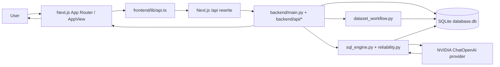
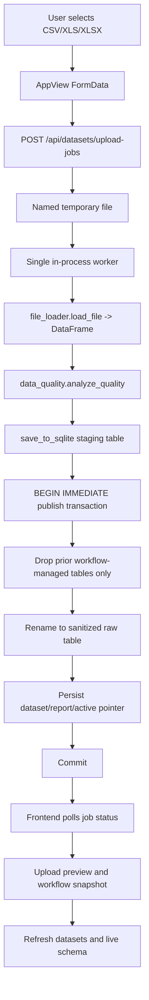
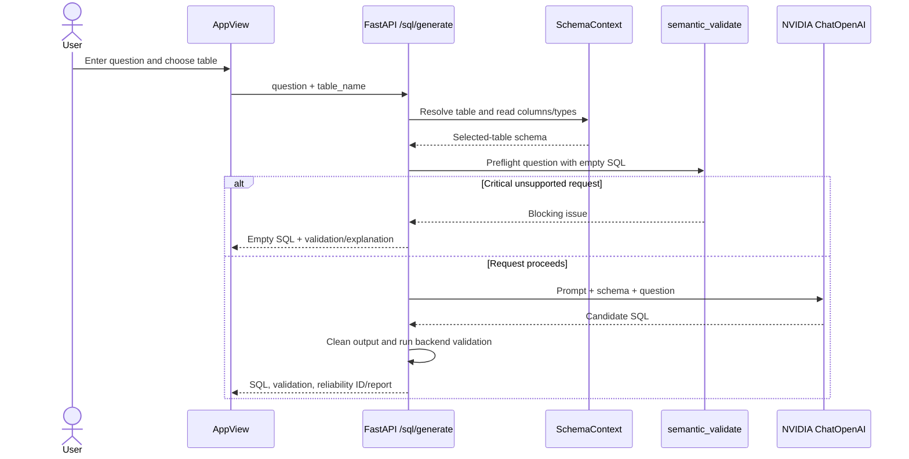
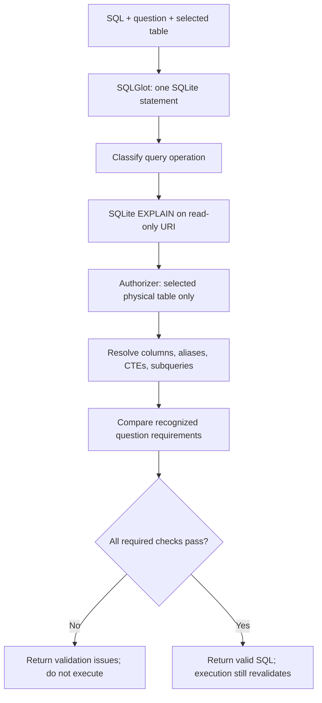
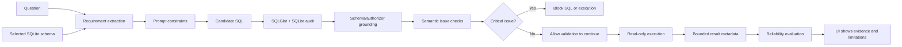
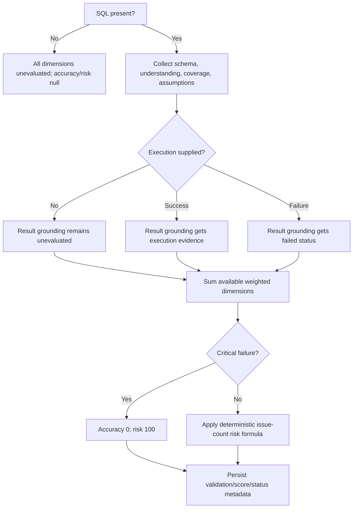
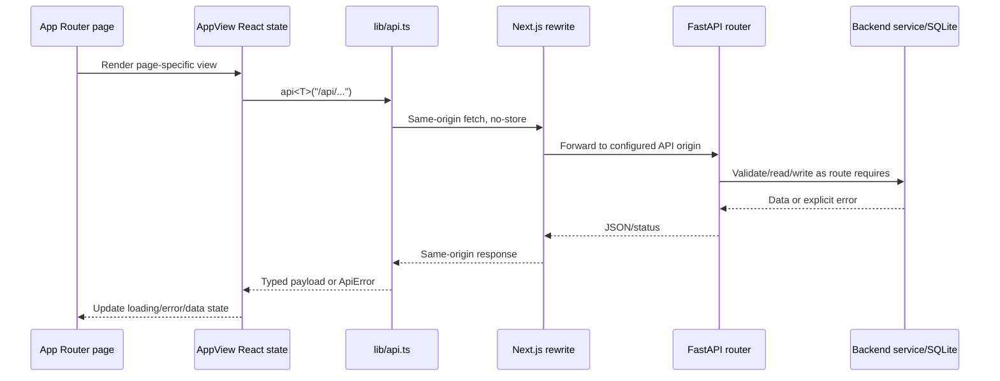

# QueryGlass AI — Complete Application Documentation

This document describes the implementation currently present in this repository. It distinguishes implemented behavior from partial safeguards and recommendations. It does not treat an executing SQL statement as proof that the statement answers the user's question.

## Status legend

- **Implemented** — present in application source and used by a route or UI.
- **Partially implemented** — a limited deterministic check or a supporting UI exists, but it does not provide a general guarantee.
- **Missing / not confirmed** — no implementation was found in the inspected source.
- **Recommended** — a future improvement, not current behavior.

## Contents

1. [Application overview and architecture](#1-application-overview-and-architecture)
2. [Pages and user interface](#2-pages-and-user-interface)
3. [Dataset upload and processing](#3-dataset-upload-and-processing)
4. [Text-to-SQL lifecycle](#4-text-to-sql-lifecycle)
5. [AI provider and model integration](#5-ai-provider-and-model-integration)
6. [SQL validation and security](#6-sql-validation-and-security)
7. [Hallucination prevention](#7-hallucination-prevention)
8. [Reliability scoring and monitoring](#8-reliability-scoring-and-monitoring)
9. [Result verification and answer grounding](#9-result-verification-and-answer-grounding)
10. [Database architecture](#10-database-architecture)
11. [HTTP API reference](#11-http-api-reference)
12. [Frontend/backend communication](#12-frontendbackend-communication)
13. [Troubleshooting](#13-troubleshooting)
14. [Performance characteristics](#14-performance-characteristics)
15. [Privacy and security](#15-privacy-and-security)
16. [Testing and quality assurance](#16-testing-and-quality-assurance)
17. [Workflow diagrams](#17-workflow-diagrams)
18. [Project structure](#18-project-structure)
19. [Local setup and execution](#19-local-setup-and-execution)
20. [Limitations and recommended improvements](#20-limitations-and-recommended-improvements)
21. [End-to-end summary](#21-end-to-end-summary)
22. [Cleanup and consolidation audit](#22-cleanup-and-consolidation-audit)

---

## 1. Application overview and architecture

### What the application does

**Implemented:** QueryGlass AI is a local web application for importing tabular data into SQLite, exploring its schema and quality, generating SQLite SQL from a natural-language request, validating that SQL against a selected table and request, and displaying a bounded preview of the database result.

The main objective is to let a user inspect the generated SQL and the server's validation evidence before execution. The backend—not browser-side checks—enforces the read-only execution policy. The UI provides schema inspection, data-quality reports, query history, a reliability report, and a deterministic reliability test center.

The product is useful for analysts, data practitioners, and developers working with tabular datasets who need a SQL starting point and a visible validation/execution workflow. It is not an authenticated multi-tenant service, an autonomous BI agent, or a statistical guarantee that a generated query is correct.

### How natural-language questions are handled

1. The user selects a live SQLite table (or the backend resolves an unambiguous active/sole table).
2. The backend reads the selected table's columns and declared SQLite types.
3. A deterministic preflight examines the natural-language question for a subset of recognizable missing objects, filters, outputs, aggregates, groupings, rankings, hypothetical counts, and unsupported medical/causal requests.
4. If that preflight finds a critical unsupported request, generation stops before the provider call.
5. Otherwise the NVIDIA-backed LangChain model receives the question and a prompt containing the selected table's schema and SQL-generation rules.
6. The model's SQL-only response is cleaned and passed through server validation.
7. The user reviews/edits SQL; the server validates it again as needed, and execution always revalidates it.
8. Results from SQLite are shown as a table, with a 500-row response cap and result-verification metadata.

The application does **not** generate a separate natural-language answer from the returned rows. Its response is generated SQL plus a generic explanation/status and a tabular result.

### Architecture and responsibilities

| Component | Responsibility | Main source |
|---|---|---|
| Next.js frontend | Pages, forms, editor, local preferences, loading/error states, schema/result/history displays | `frontend/app/*`, `frontend/components/AppView.tsx` |
| Frontend API client | Same-origin `fetch`, JSON/form-data handling, parsing errors, raising `ApiError` | `frontend/lib/api.ts` |
| Next.js proxy | Rewrites `/api/*` to the backend origin configured by `QUERYGLASS_API_URL` (default `http://127.0.0.1:8002`) | `frontend/next.config.ts` |
| FastAPI app | HTTP endpoint adaptation, request models, configuration, orchestration, HTTP errors | `backend/main.py`, `backend/api/*`, `backend/schemas/sql.py` |
| SQL generator | Constructs a schema-grounded prompt and calls NVIDIA's OpenAI-compatible API through `ChatOpenAI` | `backend/services/sql_engine.py` |
| SQL/semantic validation | SQLGlot parsing, SQLite `EXPLAIN`, selected-table authorizer, deterministic semantic checks | `backend/services/sql_engine.py`, `backend/services/reliability.py` |
| Dataset/quality services | File parsing, profiling, preprocessing, workflow transitions | `backend/services/file_loader.py`, `backend/services/data_quality.py`, `backend/services/dataset_workflow.py` |
| Persistence | SQLite access, data tables, query history and workflow/reliability metadata | `backend/db/session.py`, `backend/services/*history.py`, `database/app_tables.sql` |
| AI provider | Receives the question and selected-table schema and returns candidate SQL | NVIDIA API through `langchain-openai` |

### Implemented versus incomplete product capabilities

- **Implemented:** CSV/XLS/XLSX ingestion, persistent SQLite data, schema inspection, optional preprocessing, SQL generation, deterministic validation, read-only execution, history, reliability persistence, regression prompts.
- **Partially implemented:** question understanding, semantic correctness checks, hallucination detection, reliability/accuracy scoring, upload progress. These checks cover known patterns; they are not proofs.
- **Missing / not confirmed:** user accounts, authentication, authorization by user/table, multiple database engines, relational dataset joining, an LLM-generated answer explanation, calibrated confidence, automated database backups, production monitoring/alerting, and a browser test suite.

## 2. Pages and user interface

Each App Router page is a thin route wrapper around the shared client component `AppView`:

| URL | Page | Route file |
|---|---|---|
| `/dashboard` | Dashboard | `frontend/app/dashboard/page.tsx` |
| `/workspace` | SQL Workspace | `frontend/app/workspace/page.tsx` |
| `/schema` | Schema Explorer and upload workflow | `frontend/app/schema/page.tsx` |
| `/history` | Query History | `frontend/app/history/page.tsx` |
| `/guardrails` | Guardrails and Reliability Testing Center | `frontend/app/guardrails/page.tsx` |
| `/settings` | Settings | `frontend/app/settings/page.tsx` |

`frontend/app/page.tsx` redirects `/` to `/dashboard`. `frontend/app/layout.tsx` supplies metadata, global CSS, and the decorative `InteractiveStarfield`. `frontend/components/AppView.tsx` contains the shared navigation and page UI.

### 2.1 Dashboard

**Purpose:** Summarize live SQLite, dataset, and persisted query-history state.

**Displays:** total/successful/blocked query counts, successful-query average duration and rate, a 14-day activity chart derived from history entries, database availability/SQLite version/size, provider-configured status, connected tables with row/column counts, recent history and recent blocked/failed records.

**Actions:** Start a query; open Schema Explorer or Query History; open recent-query details; refresh live data.

**Data source:** On initial load `AppView.loadData` concurrently requests `GET /api/dashboard`, `/api/datasets`, `/api/history?limit=500`, `/api/settings`, and `/api/health`. Dashboard itself is computed by `backend.main.dashboard` from SQLite statistics (`exists`, byte/MB size, SQLite version, visible tables, total rows), active-dataset metadata, table counts/schema, query-history summary, and the latest eight history records. The chart is calculated in the browser from the fetched history.

An unavailable metric is displayed as unavailable/“—” rather than being replaced with demo data. The dashboard's “success rate” is based on persisted query-history statuses, not a model-quality probability.

### 2.2 SQL Workspace

The UI shows a five-step request/generate/validate/execute/results progress indicator. It is a visual workflow, not an independent authorization mechanism.

1. **Request:** A natural-language textarea and example chips populate the question. The selected live table is shown in the context. The page indicates whether a provider is configured. “Clear” resets the query state.
2. **Generate:** “Generate SQL” sends `{question, table_name}` to `POST /api/sql/generate`. The returned SQL is placed in the editor; the page also stores the response's reliability report/id. If no SQL is generated, the validation limitation is shown. Examples are UI shortcuts, not provider responses.
3. **Validate:** CodeMirror (`frontend/components/SqlCodeEditor.tsx`) displays editable SQL. “Validate” sends `{question, sql, table_name, reliability_id}` to `POST /api/sql/validate` and displays validity, operation, safety, syntax/schema statuses, error category, reasons, schema/hallucination findings, and semantic issues. Editing SQL invalidates prior validation/result state.
4. **Execute:** “Run query” validates first if the current editor contents do not match the SQL currently validated in the UI. The backend independently validates again in `POST /api/sql/execute`; a client state or button cannot bypass server enforcement.
5. **Results:** A successful response displays returned columns/rows, row count, duration, and truncation status. The result table supports client-side search/sort, CSV download of the returned preview, and panel maximize/restore. A zero-row success is shown as a successful empty result, not a query failure.

The sidebar exposes the live schema for the selected table, column type distribution, a short column list/search, foreign-key metadata returned by SQLite, links to Schema Explorer, and a generic explanation of the parsed operation and read-only policy. It explicitly warns that deterministic validation does not guarantee semantic correctness.

**Answer Reliability panel:** Reports answer-accuracy score, hallucination-risk score/label, validation and execution statuses, evaluated coverage, weighted dimensions, detected issues, and result-verification metadata (database source, actual columns/counts, preview null counts, and truncation). Before SQL exists, the UI says “Awaiting SQL generation”; after SQL exists but before server validation it says “Awaiting SQL validation.”

### 2.3 Schema Explorer

**Purpose:** Upload/replace the active app-managed dataset, review quality, optionally preprocess and store a cleaned version, and inspect live SQLite tables.

**Upload controls:** accepts `.csv`, `.xlsx`, `.xls`; shows upload job stage, elapsed time, rows processed when known, failure details, filename, row/column counts, column types/null counts/sample values, and a bounded preview.

**Workflow controls:** displays the persisted raw/processed quality report and workflow stage; exposes configurable preprocessing rules; offers “Preprocess Data,” before/after comparison, applied transformations, and “Save Cleaned Dataset.” These actions are explicit and separately gated by backend workflow state.

**Schema exploration:** lists tables and row/column counts; expands a table to show columns, declared SQLite type, key/nullability indicators, foreign-key metadata, and a read-only 25-row browser with bounded search and pagination. A drawer can filter/sort all columns and copy names. A delete confirmation is required before table deletion.

**Schema source:** `GET /api/datasets` obtains visible table metadata and active-dataset metadata. `GET /api/datasets/{table}/schema` reads SQLite `PRAGMA table_info`, `foreign_key_list`, and `index_list`; schema details are not held as authoritative permanent metadata for arbitrary user tables. For a selected workspace table, the frontend separately fetches this live schema. `GET /api/datasets/{table}/rows` reads rows read-only.

### 2.4 Query History

Shows stored history records, counts, duration distribution, and search/status filters. Selecting a record opens a detail dialog with question/SQL, status, rows, duration, timestamp, and error message. “Open in workspace” copies the saved question and SQL to `sessionStorage` and routes to `/workspace`.

The history record schema stores `question`, `sql_query`, `status`, `row_count`, `execution_time_ms`, and `error_message` plus ID/timestamp. It does **not** store dataset ID, result cell contents, validation JSON, or reliability scores. Reliability evaluations are stored separately.

### 2.5 Guardrails

Displays backend validation checks for a user-entered statement, recent blocked/failed history, declared execution safeguards, and the reliability test catalog/monitoring summary. “Validate statement” calls `/api/sql/validate` with an empty question and selected table; it does not execute SQL. The test center runs individual or all predefined prompts via `/api/reliability/tests/run` and shows actual result details.

The page explicitly notes that browser UI is not a security boundary and that validation does not execute SQL. It also labels authentication/table roles as not configured and production risk analytics as unavailable.

### 2.6 Settings

**Browser-local settings:** light/dark theme, reduced motion, and compact result tables are persisted in browser `localStorage` under `queryglass.preferences`.

**Read-only server diagnostics:** provider configured/not configured, configured model name, SQLite availability/table count/database file size, backend connection status, result preview limit, query timeout, and the API proxy address. “Test connection” calls `/api/health`.

Provider credentials cannot be entered into the UI. The server reports only whether a provider key exists and declares `secrets_sent_to_browser: false`. Database/provider settings are not editable here.

## 3. Dataset upload and processing

### 3.1 Upload process

**Supported formats:** `.csv`, `.xls`, `.xlsx`. The browser `accept` attribute is only a convenience; the backend independently checks the filename suffix.

The Schema Explorer uses the background-job path:

1. `AppView.inspectUpload` sends a `FormData` file to `POST /api/datasets/upload-jobs`.
2. FastAPI checks extension and byte size. The request returns an in-process job record.
3. The server copies the upload to a named temporary file, queues work on a one-worker `ThreadPoolExecutor`, and the frontend polls `GET /api/datasets/upload-jobs/{job_id}` every 750 ms.
4. The worker reports `parsing`, `analyzing`, `storing`, `publishing`, `finalizing`, `completed`, or `failed`, with elapsed time and inserted row progress when available.
5. The temporary file is removed by the worker's `finally` block.

`POST /api/datasets/upload` is also available for synchronous ingestion and runs parsing/persistence in a worker thread. It reads the `UploadFile` stream directly; the UI currently uses upload-jobs.

**Validation and errors:** unsupported extension returns HTTP 415; over-limit file returns 413; parse failures return 400; workflow/persistence errors use `WorkflowError` status/detail; inability to inspect file size or enqueue a job can return 500. A dataset with no rows, duplicate column names, or an unparseable file is rejected. API exceptions are logged and surfaced as HTTP details where defined; some SQLite helper functions intentionally return empty/default values on database errors, so not every low-level error is propagated.

**Limits:** `QUERYGLASS_MAX_UPLOAD_BYTES` overrides the backend limit. Its code default is 5 GiB. The actual configured value depends on the server environment and is not stated here. Next.js proxy timeout is configured to 30 minutes for long uploads.

### 3.2 Processing stages and source functions

| Stage | Actual behavior | Responsible code |
|---|---|---|
| Receive | FastAPI `UploadFile`; basename/suffix and byte-size checks | `backend/api/schema.py`, `backend/main.py:upload_dataset`, `start_upload_job` |
| Temporary job file | Job route copies in 8 MiB blocks to a named temporary file; worker deletes it at completion/failure | `backend/main.py:_process_upload_job`, `start_upload_job` |
| Parse | CSV via `pandas.read_csv(dtype=str, keep_default_na=False)`; Latin-1 retry after a CSV parse exception; Excel via `read_excel(dtype=str, keep_default_na=False)`; trims header whitespace | `backend/services/file_loader.py:load_file` |
| Header validation | Rejects duplicate post-trim column names | `backend/services/dataset_workflow.py:ingest_upload` |
| Quality analysis | Calculates row/column/cell counts, missing values, exact duplicate rows, type mismatches/invalid values, outliers, constants, empty rows/columns | `backend/services/data_quality.py:analyze_quality` |
| Raw staging table | Writes the DataFrame to a unique hidden SQLite staging table using `save_to_sqlite` | `backend/services/dataset_workflow.py:ingest_upload`, `backend/db/session.py:save_to_sqlite` |
| Atomic publish | In `BEGIN IMMEDIATE`, removes only prior workflow-managed raw/processed/staging tables and metadata, renames the upload stage to a unique sanitized table name, inserts dataset metadata/report, and updates the active pointer; commit publishes it | `backend/services/dataset_workflow.py:ingest_upload` |
| Preview | Builds an inspection summary and bounded preview (500 rows) for the upload response | `backend/services/file_loader.py:inspect_dataset`, `backend/services/payload.py:frame_payload` |
| Optional preprocess | Reads raw table to a DataFrame; runs user-selected transformations on a copy; writes a hidden staging table; recalculates quality; saves run/report state | `backend/services/dataset_workflow.py:start_preprocess_run`, `backend/services/data_quality.py:preprocess_dataframe` |
| Store cleaned result | Validates staged row/column counts, then transactionally renames the staged table to a `*_processed` name and records the version | `backend/services/dataset_workflow.py:finalize_run` |
| Schema refresh | Frontend reloads datasets and fetches live schema | `frontend/components/AppView.tsx`, `/api/datasets`, `/api/datasets/{table}/schema` |

**Type detection:** imported CSV/Excel values are initially read as strings. `analyze_quality` infers dominant value types for quality checks, but this is not the same as changing the raw table's types. `convert_data_types` and other transformations run only when preprocessing is explicitly requested.

**Preprocessing options:** backend option validation recognizes `remove_duplicates`, `duplicate_subset`, `missing_value_strategy`, `numeric_fill_value`, `categorical_fill_value`, `column_strategies`, `drop_columns`, `clean_whitespace`, `standardize_column_names`, `convert_data_types`, `standardize_categorical`, `invalid_value_strategy`, `outlier_strategy`, `remove_empty_rows`, and `remove_empty_columns`. The UI exposes a subset via `/api/datasets/preprocessing-rules`. The pipeline can trim whitespace, normalize missing values, standardize names, drop selected/empty rows or columns, normalize categories, handle invalid values, convert types, fill/drop missing values, remove duplicates, and cap/remove outliers. Defaults are documented in `backend/services/data_quality.py:preprocess_dataframe`; missing-value default is `leave`, and several other operations default on.

The report's `parsing_errors` is currently zero because parsing is all-or-nothing; it does not represent partial-row error recovery. Outlier and constant-column counts are advisory and are not added to `total_issues`. The exact issue-count formula is missing cells + invalid/type-mismatched values + extra exact duplicate rows.

### 3.3 Where uploaded data is stored

- **Engine/path:** SQLite through Python `sqlite3`, no ORM. The canonical and only database path is `<project root>/database.db`. The path is not returned by the settings endpoint.
- **Original uploaded file:** there is no durable copy/archive of the file. The parsed data is stored in a SQLite table. The background-job route uses a temporary file during processing and deletes it in `finally`.
- **Raw table:** `sanitize_table_name(Path(filename).stem)` lowercases, strips unsupported characters, maps whitespace/hyphens to underscores, prefixes numeric-leading names with `tbl_`, then appends a numeric suffix if needed. Raw content is preserved in that table.
- **Processed table:** after successful explicit preprocessing and “Save Cleaned Dataset,” the staged result is renamed to a sanitized `<source stem>_processed` table, with numeric collision suffix as needed. Raw data remains intact. A later stored version for the same dataset identity replaces the prior processed table transactionally.
- **Metadata:** `_queryglass_datasets`, `_queryglass_dataset_identities`, `_queryglass_active_dataset`, `_queryglass_processing_runs`, `_queryglass_processed_versions`, `_queryglass_quality_reports` (see [Database architecture](#10-database-architecture)).
- **Persistence:** SQLite data and registry rows survive API/page restarts. Upload job state itself is process-local and does not survive process restart; workflow registry data does.
- **Active dataset:** a singleton `_queryglass_active_dataset` row identifies the current workflow-managed upload. A successful new upload replaces all prior workflow-managed uploads and reports; unrelated user-created tables and query history are preserved. `dataset_identity` can group replacement lifecycle records, but the normal frontend upload does not send an explicit identity.
- **Deletion:** `DELETE /api/datasets/{table_name}` removes the selected table and related workflow tables/metadata where applicable. Deleting a processed table does not necessarily delete the raw upload. No soft-delete/recovery UI or automated backup is implemented.
- **Column metadata:** workflow registry stores JSON column name/type metadata. Live SQLite schema inspection remains the source for actual types, nullability, primary keys, foreign keys, defaults, and indexes.
- **Indexes:** explicit indexes exist on selected workflow/reliability metadata columns. The upload writer does not create workload indexes for imported data tables. SQLite's `PRAGMA index_list` is used to report any indexes that exist.

### 3.4 Large dataset behavior

**Implemented:**

- Ingestion parses a complete file into a pandas DataFrame in memory.
- The upload route offloads parsing and persistence from the ASGI event loop to a worker thread. The UI-selected upload-job endpoint reports stages and actual SQLite inserted-row counts.
- SQLite persistence uses `DataFrame.to_sql` with chunking. `QUERYGLASS_SQLITE_INSERT_CHUNK_ROWS` defaults to 1,000; the writer caps chunk rows to keep at most approximately 20,000 bound values per chunk.
- Staging and publication use a transactional design to preserve the prior active upload if publish fails.
- Upload job executor has one worker, at most 100 retained in-memory jobs, and a one-hour retention period for completed/failed jobs.

**Limitations / recommendations:** quality scans and type profiling still traverse the full DataFrame; preprocessing reads full tables to memory; API response includes a 500-row upload sample; no indexes are added automatically to imported data. For workloads such as 187,531 rows × 21 columns, the source contains no measured benchmark for that exact size. A test exercises 20,000 rows × 2 columns, which is not an equivalent benchmark.

Recommended (not implemented): record repeatable time/peak-memory benchmarks for representative row/width distributions; profile individual quality passes; consider streaming CSV ingestion or chunk-aware analysis only if transformations can preserve current semantics; create indexes only from measured query needs; bound upload job queue admission and expose job persistence if uploads must survive process restarts. Current chunking and job tracking already exist and should be benchmarked before replacing.

## 4. Text-to-SQL lifecycle

### Request and response

`POST /api/sql/generate` accepts a JSON `GenerateRequest`: `question` (1–2,000 characters, required) and optional `table_name` (1–100 characters). If omitted, the backend resolves the active raw table, or the sole table if unambiguous; it returns 404 when no table exists and 422 if multiple tables exist without an active upload. The response includes `sql`, resolved `table_name`, `validation`, `reliability` (null if no SQL), `reliability_id`, and a generic `explanation`.

### Detailed flow

1. `frontend/components/AppView.tsx:generateSql` posts the question and selected table.
2. `backend.main.generate` resolves a table and creates `SchemaContext`.
3. `SchemaContext.to_schema_text()` reads the one selected table's physical columns, SQLite declared types, NOT NULL flags, and primary-key flags.
4. `semantic_validate(question, "", ...)` checks whether it can identify a critical unsupported question before calling the AI. Missing requested columns/tables and selected unsupported diagnosis/prompt-injection patterns can block generation with an empty SQL string.
5. `backend.services.sql_engine.generate_sql` invokes `ChatOpenAI` against NVIDIA's OpenAI-compatible API with the question, selected table, and schema. The prompt requires one SQLite-compatible read-only SELECT; disallows invented objects/values/relationships; says not to silently omit requested requirements; and permits CTEs, subqueries, joins, aggregates, CASE, and windows where appropriate.
6. `clean_sql_output` strips markdown fences and selected explanatory lines. No model-generated SQL is treated as trusted.
7. `_validate` calls the SQL audit, SQLite-backed grounding/schema validation, and semantic validator. `WITH ... SELECT` is classified as a SELECT. The validation response is included immediately with generated SQL.
8. A reliability evaluation record is inserted in `_queryglass_reliability_history` for non-empty generated SQL.
9. The UI displays SQL for review/edit. Its editor and selected table are client state; a table change and editing invalidate prior validation/result evidence as applicable.
10. `POST /api/sql/validate` validates current SQL. `POST /api/sql/execute` revalidates even if a prior validation was returned.
11. The database is queried read-only with a selected-table authorizer and a five-second SQLite progress-handler cutoff. Up to 501 rows are fetched to detect whether the 500-row preview is truncated; the first 500 are returned.
12. The backend records a result-verification summary and updates/creates the reliability record. The UI renders the result rows and verification facts.

**Answer explanation:** there is no separate AI answer-synthesis endpoint in the current routes. `generate.explanation` is a static status message; the workspace's “Query explanation” describes the parsed operation and policy, not a grounded natural-language summary of result values.

**Schema scope:** the model prompt is built for a single selected table. Runtime schema authorization permits physical reads only from that selected table. Other physical-table joins are blocked; CTEs and subqueries may derive intermediate relations from the selected table.

## 5. AI provider and model integration

- **Provider implemented:** NVIDIA's OpenAI-compatible API through `langchain-openai` `ChatOpenAI`.
- **Key:** `NVIDIA_API_KEY` is loaded from server environment/dotenv. It is not returned to the frontend; `/api/health` and `/api/settings` expose only a boolean configured flag.
- **Endpoint/model:** `NVIDIA_API_BASE_URL` controls the OpenAI-compatible endpoint and `NVIDIA_MODEL` controls the model; the source default model is `mistralai/mistral-large-4-1t-a52b`. The API returns this model name in diagnostics and records it with reliability evaluations. It is not a client-side selection.
- **Prompt:** constructed in `backend/services/sql_engine.py:generate_sql` with one selected table's schema, the question, read-only/SQLite rules, schema grounding, no invented objects or user assumptions, and no fabricated results.
- **Response processing:** strips fences and selected comments/preamble; then validates the resulting SQL. Empty output is represented as no SQL and is not executed.
- **Failure behavior:** missing key raises an explicit `ValueError`; the generation route converts generation exceptions to HTTP 503 with a message. Provider-backed reliability tests return 503 when required and the key is absent.
- **Timeout/retries:** no application-level timeout or retry is configured in the inspected `ChatOpenAI` construction/invocation. Underlying library defaults are not treated as an application guarantee.
- **Privacy boundary:** the question and schema are sent to the configured external provider for generation. The app does not send API credentials to the browser. Provider-side data handling is governed by that provider; no application-level prompt redaction or PII classification was found.

## 6. SQL validation and security

Validation is performed in the backend by `backend.main._validate`, `backend.services.sql_engine`, and `backend.services.reliability`. Frontend status indicators only display results; they do not authorize execution.

### 6.1 Syntax and statement validation

- SQLGlot parses using the SQLite dialect; multiple parsed statements are rejected.
- A query AST (`exp.Query`), including CTEs/set queries, is classified as SELECT only if it does not contain prohibited write/DDL/command nodes.
- SQLite `EXPLAIN` compiles the statement on a `mode=ro` connection, catching SQLite syntax and schema compile errors.
- Incomplete/empty or multiple statements receive explicit validation errors. The code handles semicolons in strings via parser-based statement validation.
- `PRAGMA`, `EXPLAIN` as a user operation, commands, and non-query statements are not accepted as executable SQL.
- CTEs, aliases, recursive CTEs, subqueries, window functions, and derived columns are supported insofar as SQLite can compile them while the authorizer sees only the selected physical table.

### 6.2 Schema validation

- `SchemaContext` obtains real columns using SQLite metadata.
- SQLite's query compiler resolves names and aliases; validation does not naively classify every CTE alias as a physical field.
- Only the selected physical table is authorized by the SQLite authorizer. References to another table, even if it exists, are rejected.
- Unknown table/column/CTE errors are returned with categories where classified.
- A selected-table reference is required; a query that does not read it is rejected.
- The prompt and SQL validator do not infer JOIN relationships. The selected-table-only policy blocks cross-table relationships rather than verifying them.

### 6.3 Semantic validation

The AST-based deterministic validator attempts to extract and compare:

- Recognized column mentions and missing underscored identifiers/table references.
- Certain numeric comparisons and `BETWEEN` filters (e.g. greater/less/above/below).
- Requested output columns, wildcard output, aggregation type/metric, grouping dimensions, top-N ranking/order/limit.
- Certain relative-average/extreme-pair patterns, percentage denominators, hypothetical row counts, contradictory conditions, and arbitrary constant-false fallbacks.
- Selected prompt-injection and unsupported-diagnosis patterns.

These are **partial** language/AST heuristics, not full natural-language understanding. Synonyms, complex multi-clause meaning, implicit business rules, units, subtle join semantics, general NULL reasoning, and arbitrary causal/sensitive claims are not exhaustively understood. A query may pass syntax/schema/execution and still answer the question incorrectly.

### 6.4 Security validation and execution controls

**Enforced by backend:**

- One SQL statement only.
- Query/SELECT AST only; mutation/DDL operations are blocked.
- SQLite opens execution connections with `mode=ro`, sets `PRAGMA query_only=ON` and `trusted_schema=OFF`, and installs an authorizer.
- Authorizer permits reads only from the selected physical table, permits SELECT/recursive-select and ordinary functions, and denies `load_extension` and other SQLite actions.
- SQLite progress handler aborts after approximately five seconds of query execution; connection lock timeout is two seconds.
- Results are capped to 500 rows in the response (fetch 501 to determine preview truncation).
- Execution always calls backend validation first; invalid statements return HTTP 422. Single-statement parsing failures return HTTP 400.

**Not implemented / not a guarantee:** API authentication/authorization, per-user table access, SQL cost estimation, a separate result-size byte limit, a general query cancellation endpoint, process isolation for the provider, and application-level rate limits. The five-second progress handler is an execution cutoff, not a complete resource-governance system.

## 7. Hallucination prevention

In this application, a SQL hallucination is unsupported SQL structure or intent—such as an invented physical object/value, a dropped requested condition, or an unsupported inference. The system uses prompt instructions plus deterministic checks; it does not use a trained hallucination classifier or prove all generated output is correct.

### 7.1 Coverage by hallucination type

| Type | Example | Current handling | Remaining gap |
|---|---|---|---|
| Fabricated table | `FROM internship_experience` when absent | Semantic identifier precheck and SQLite schema/authorizer reject missing or unauthorized table | Identifier/context extraction is heuristic |
| Fabricated column | Filter on nonexistent `parental_income` | Precheck can block before provider; SQL compilation/grounding reports unknown column | Does not understand every paraphrase or quoted/domain-specific name |
| Incorrect JOIN relationship | Join two tables on guessed `student_id` | Only selected physical table is readable; cross-table read is rejected; selected-table self-join has a limited check | No relationship inference/verification; multi-table joins are not supported |
| Missing `WHERE` condition | Omit `cgpa > 3` | Recognized requested numeric filters are compared against SQL AST; missing filter is critical | Only extracted supported filter patterns are checked |
| Incorrect filter | Use wrong threshold/operator/value | Recognized filters compared; unrequested literal conditions and contradictory numeric bounds detected | Units, dates, categorical interpretation, logical equivalence and some OR/nesting cases are not a general theorem prover |
| Incorrect aggregation | `SUM` when average requested | Recognized aggregate term/column compared against AST aggregate | Natural language mapping is limited |
| Incorrect `GROUP BY` | Aggregate by wrong dimension | Recognized “by/each/per” column requirements compared with GROUP BY/window partition | Complex grain semantics and aliases are only partially covered |
| Incorrect sorting | Ascending rather than descending for top/highest | Top-N check inspects ORDER BY and direction | Other sorting language/special tie behavior is not fully analyzed |
| Unsupported calculation | Invented calculation or denominator | Percentage and certain aggregate/extreme patterns checked; issues can be critical | No general mathematical intent proof |
| Invented records | Return a row not in data | SQL engine executes against SQLite; result rows come from database | No independent provenance proof for each row beyond DB execution |
| Invented values | Claim a value not returned by DB | No separate generated prose answer exists; UI displays returned rows | Future answer synthesis would need cell-level grounding |
| Unsupported causal conclusion | “Sleep caused lower CGPA” | Limited lexical check for cause phrases with sleep/screen/study/etc. | Not a general causal inference detector |
| Unsupported medical/sensitive conclusion | “Who has depression?” | Limited diagnosis/medical keyword check rejects recognized requests lacking an appropriate measured field; causal diagnosis phrase also rejected | Not a comprehensive medical, sensitive-attribute, or fairness policy |
| Ignoring unavailable data | Silently use another metric/table | Missing objects are flagged; prompt forbids substitution/fallback; selected-table validation blocks unauthorized tables | Not every conceptual data gap can be inferred from schema |
| Hypothetical values treated as facts | “Pretend 10,000 rows” used as actual divisor | Recognizes selected hypothetical-count language and flags matching SQL literal; percentage checks expect a database-derived denominator | Pattern-based; not a universal detection of every hypothetical |
| Wrong answer despite valid SQL | Valid query answers a neighboring question | Deterministic semantic checks cover selected requirements; UI warns correctness is not guaranteed | No independent answer oracle or exhaustive semantic model |
| Fabricated result explanation | Claim a trend not in returned rows | No LLM-generated result explanation is currently produced | Static explanation is not an answer; future summaries need grounding |
| Incorrect NULL interpretation | Treat NULL as zero/absence | JSON payload converts pandas missing values to `null`; UI renders null explicitly and reports preview null counts | No general semantic policy for how NULL should affect a requested calculation |

### 7.2 Prevention pipeline

The implemented path and its limits:

1. **Question understanding (partial):** `extract_requirements` recognizes selected columns, filters, output fields, aggregate/group/rank terms, hypothetical counts, and selected unsupported diagnoses.
2. **Schema grounding:** selected table/columns come from SQLite; missing requested objects can block generation.
3. **SQL generation:** NVIDIA prompt asks for one SQLite read-only SELECT grounded in supplied schema and all key requirements.
4. **SQL parsing:** SQLGlot parses one SQLite statement; operation nodes are classified.
5. **Schema validation:** SQLite `EXPLAIN` and authorizer resolve names and limit physical reads to selected table; CTE aliases are allowed.
6. **Semantic validation:** AST is checked against the requirements recognized from the question.
7. **Security validation:** read-only, one-statement and authorized-table restrictions are checked.
8. **Execution:** only valid SQL is run against the configured SQLite database with progress cutoff.
9. **Result verification:** actual returned columns, rows in preview, truncation and preview null counts are recorded.
10. **Reliability evaluation:** weighted engineering score summarizes only measured dimensions; critical errors override.
11. **Answer grounding:** currently the UI presents the actual returned data, not a generated prose answer. There is no independent proof that the result matches the entire question.

### 7.3 Required failure scenarios

| Scenario | Current behavior / evidence |
|---|---|
| A. Missing column (`parental_income`) | **Implemented for recognized names:** question precheck returns empty SQL with `unknown_column`, before provider call. `test_missing_requested_column_blocks_generation_without_calling_provider` covers a similar request. |
| B. Hypothetical 10,000 rows | **Partially implemented:** extracted hypothetical count is rejected if used as an SQL literal; percentage denominator must be database-derived. `test_hypothetical_dataset_size_cannot_be_used_as_denominator` covers this. Not a general reasoning system for all hypotheticals. |
| C. Unsupported depression diagnosis | **Partially implemented:** selected diagnosis/causality phrases produce critical `unsupported_diagnosis`; test coverage exists. This is lexical and not a comprehensive medical policy. |
| D. Missing table / unsupported join | **Implemented within selected-table policy:** missing table and unselected table are rejected; reads from any second physical table are denied. A join cannot be enabled merely by claiming a relationship. |
| E. Valid CTE/window query | **Implemented:** SQLite authorizer/query compiler resolves CTEs, aliases, nested selects and windows. CTE, recursive CTE, and complex query tests exist. |
| F. Missing required filter | **Partially implemented:** recognized numeric filters are matched against SQL AST and omissions are critical. Regression tests cover multiple filters and omitted conditions. Arbitrary natural-language condition equivalence remains unverified. |
| G. Execution succeeds but question is answered incorrectly | **Acknowledged but not fully preventable:** `SUCCESS` means SQLite executed; semantic checks have finite coverage. UI explicitly warns that execution verification does not prove semantic correctness. |

## 8. Reliability scoring and monitoring

Weights are implemented in `backend/services/reliability.py:score_reliability` and mirrored in the frontend:

| Dimension | Weight | Current evidence |
|---|---:|---|
| Schema grounding | 25 | Schema validation boolean |
| Question understanding | 20 | `question_understanding_status` from the deterministic requirement extractor |
| SQL requirement coverage | 25 | Required filter/output/group/aggregate/rank issue checks |
| Result grounding | 20 | Not evaluated until execution; success marks returned database result as verified |
| Unsupported assumptions | 10 | Selected unsupported diagnosis, denominator, relationship, and assumption issue types |
| **Total possible** | **100** | Sum of weights; not a calibrated probability |

### Formula and statuses

- **No SQL:** all dimension scores are `null`; accuracy and risk are `null`; evaluated weight is 0; stage is `awaiting_sql_generation`; validation says “Awaiting SQL generation.” This is intentionally distinct from a critical SQL failure.
- **SQL exists, not executed:** result-grounding is unevaluated, so evaluated weight is below 100. Schema, understanding, coverage, and unsupported-assumption dimensions get full/zero/null according to the statuses described by the implementation.
- **Accuracy:** sum of available earned dimension scores. If a critical failure exists (syntax failure, not read-only, invalid schema, invalid semantic status, or a critical issue), accuracy is overridden to 0.
- **Risk:** critical failure sets risk to 100. Otherwise it starts at 5, adds 25 when semantic status is `not_fully_verified`, adds 18 per issue capped at 70, and is capped at 100. An invalid schema has a minimum risk of 85. Risk labels are “Very Low” (≤10), “Low” (≤30), “Moderate” (≤60), “High” (≤80), or “Critical.”
- **After execution:** result-grounding gets 20 for execution status `SUCCESS` and 0 otherwise. This confirms a database result was obtained, not that SQL semantically answers the question. Critical failures continue to override the overall accuracy/risk.
- `evaluated_weight` is the sum of weights for dimensions with a non-null score. “Not evaluated” means evidence is insufficient, not a score of zero.

The values are deterministic engineering indicators. They are **not statistically calibrated probabilities**, and the “answer accuracy” value is not a measured factual accuracy rate. Execution success can contribute points but cannot alone earn a high score because dimensions are separate and critical failures override.

### Persistence

`_queryglass_reliability_history` stores evaluation ID/timestamps, question, table, generated SQL, provider model, source/stage, test/hallucination flags, pass state, accuracy/risk integers, validation JSON, execution status, and execution metadata JSON. Generation creates a record for nonempty SQL; validate/execute update the supplied reliability ID or create one. Returned result values themselves are not persisted in the execution metadata. The summary endpoint returns aggregates/trends and up to 25 recent evaluations from a recent-500-row scan.

## 9. Result verification and answer grounding

`backend.main.execute` revalidates, executes SQLite read-only SQL, reads at most 501 rows, returns at most 500, and reports:

- `columns`: actual cursor result column names.
- `rows`: returned preview values JSON-normalized.
- `row_count`: number of rows returned in the response (up to 500), not a full exact count when truncated.
- `truncated`: whether a 501st row existed.
- `duration_ms`: elapsed execution time.
- `result_verification`: `{source:"database_execution",columns,rows_returned,row_count_exact,truncated,null_counts,null_count_scope:"returned_preview"}`.
- `status`: `SUCCESS`; empty result sets are valid successful executions.

Pandas/NumPy missing values are converted to JSON `null` by `backend/services/payload.py:json_value`; the UI displays `NULL` and may show preview null counts. This does not imply NULL was interpreted as numeric zero or analyzed for all rows.

**Frontend contract gap:** the current backend verification object uses `source`, `columns`, and `rows_returned`, while the frontend `ResultVerification` display reads `database_source`, `actual_columns`, and `actual_row_count`/`actual_column_count`. As a result, some verification labels may display “Not provided” even though the API returned the information under its backend field names. The UI and test-center TypeScript types also describe the alternate names. This is a reporting mismatch, not evidence that the underlying SQL result was not executed.

**What is verified:** the selected database executed the validated SQL and returned these columns/rows within resource and preview limits.

**What is not verified:** the code does not establish that the generated SQL answers every nuance of the question, nor does it produce a separate prose answer and prove every sentence against result cells. Semantic checks are heuristic. When `truncated` is true, counts/null counts refer to the bounded preview unless otherwise labeled; they are not full-result counts.

## 10. Database architecture

### Engine, path, connection and lifetime

- SQLite, accessed through `sqlite3`; pandas `to_sql` is used for table writes. No ORM is present.
- The only database file is project-root `database.db`; alternate database paths are not supported.
- Registry/history schemas are created lazily and idempotently from `database/app_tables.sql`; workflow initialization also applies compatibility migrations. There is no separate migration CLI.
- SQLite commits and explicit transactions are used for workflow publication, processing-run records, and history/reliability writes. On replacement failures, staging is removed and/or the transaction rolls back.
- The default file is git-ignored. Automated backup, restore, encryption-at-rest, and retention/cleanup of historic database backups are not implemented/confirmed.

### Application metadata tables

`database/app_tables.sql` defines:

| Table | Stored information |
|---|---|
| `_queryglass_history` | Query event: ID, timestamp, question, SQL, status, row count, duration, error message |
| `_queryglass_datasets` | Dataset identity, filename, raw table name, created time, dimensions, JSON columns metadata, status/error |
| `_queryglass_dataset_identities` | Normalized filename and active/processing dataset pointers per identity |
| `_queryglass_active_dataset` | Singleton `active` pointer to the active workflow dataset |
| `_queryglass_processing_runs` | Options, state/timestamps, row/column counts, staging table, transformations/error, finalized flag |
| `_queryglass_processed_versions` | Processed table name, dataset/run IDs, dimensions, operation config and creation time |
| `_queryglass_quality_reports` | Raw/processed quality metrics as JSON, stage/run and creation time |
| `_queryglass_reliability_history` | Created lazily by reliability history service; evaluation/validation/execution and test metadata |

Indexes are created for dataset status, dataset/run lookup, processed versions by dataset/date, quality reports by dataset/stage/report, and reliability created time. These metadata tables have logical references by IDs but the inspected DDL does not declare foreign-key constraints. Dynamic uploaded tables are ordinary SQLite tables, not child tables with declared keys; schema foreign keys, if any, are read from the actual table.

### Current local database schema snapshot

The root `database.db` was inspected using SQLite schema metadata only; no table rows were read. It contains the application metadata tables, dataset tables, and traceability tables. Staging-table presence and generated suffixes are transient and may change with workflow activity.

The current `house_prices` table has 21 columns, all declared `TEXT`, with no primary-key or `NOT NULL` flags:

| Column | SQLite declared type |
|---|---|
| `Index` | `TEXT` |
| `Title` | `TEXT` |
| `Description` | `TEXT` |
| `Amount(in rupees)` | `TEXT` |
| `Price (in rupees)` | `TEXT` |
| `location` | `TEXT` |
| `Carpet Area` | `TEXT` |
| `Status` | `TEXT` |
| `Floor` | `TEXT` |
| `Transaction` | `TEXT` |
| `Furnishing` | `TEXT` |
| `facing` | `TEXT` |
| `overlooking` | `TEXT` |
| `Society` | `TEXT` |
| `Bathroom` | `TEXT` |
| `Balcony` | `TEXT` |
| `Car Parking` | `TEXT` |
| `Ownership` | `TEXT` |
| `Super Area` | `TEXT` |
| `Dimensions` | `TEXT` |
| `Plot Area` | `TEXT` |

This is a snapshot of the local ignored database, not a schema guarantee for another installation or a future upload. Uploaded tables are created dynamically from the imported file.

| Logical relationship | Metadata reference |
|---|---|
| Dataset → processing runs | `_queryglass_processing_runs.dataset_id` |
| Dataset → processed versions | `_queryglass_processed_versions.dataset_id` |
| Processing run → processed version | `_queryglass_processed_versions.run_id` |
| Dataset → quality reports | `_queryglass_quality_reports.dataset_id` |
| Dataset identity → active/processing datasets | `_queryglass_dataset_identities.active_dataset_id`, `processing_dataset_id` |
| Active dataset pointer → dataset | `_queryglass_active_dataset.dataset_id` |
| Query history and reliability history | Separate records; neither is linked to dataset IDs |

These are application-level ID references, not declared SQLite foreign-key constraints.

## 11. HTTP API reference

All listed routes are unauthenticated in the current application. JSON bodies use Pydantic request models where shown. FastAPI supplies standard `detail` errors; route-specific status codes are noted. The frontend normally calls these through the same-origin Next.js rewrite.

### Health/status and dashboard

| Method / URL | Purpose and request | Response / errors | Implementation / caller |
|---|---|---|---|
| `GET /` | Service discovery; no body | `{service, status, health, docs, frontend}` | `backend/api/health.py` → `backend.main.root` |
| `GET /api/health` | DB availability/connectivity and provider status | `{status, database_exists, database, provider_configured, model, api_key_exposed}`; returns 503 when DB missing/unavailable | `backend/api/health.py` → `backend.main.health`; AppView initial load/Settings |
| `GET /api/dashboard` | Live summary; no body | `{database:{exists,size_bytes,size_mb,sqlite_version,tables,total_rows}, tables:[{name,rows,columns}], active_dataset, history, recent_queries}` | `backend/api/dashboard.py` → `backend.main.dashboard`; Dashboard |
| `GET /api/settings` | Read-only configuration diagnostics | `{backend, database_exists, provider_configured, model, secrets_sent_to_browser, limits:{upload_bytes,query_timeout_seconds,result_preview_rows}}` | `backend/api/settings.py` → `backend.main.settings`; initial load/Settings |

### Dataset and schema APIs

| Method / URL | Input | Response / errors | Implementation / caller |
|---|---|---|---|
| `GET /api/datasets` | None | `{datasets:[{name,rows,schema}], active_dataset}` | `backend/api/schema.py`; Dashboard, Workspace, Schema |
| `GET /api/datasets/preprocessing-rules` | None | `{rules:[{id,code,title,description,impactText,category,option_key,type,default,choices?}]}` | `backend.main.get_preprocessing_rules`; Schema |
| `GET /api/datasets/workflow` | None | `{datasets:[...]}` for workflow-managed active upload | `backend.main.workflow_datasets` |
| `GET /api/datasets/workflow/{dataset_id}` | Dataset ID | Dataset snapshot including raw/processed reports, runs, versions, allowed actions, optional comparison; 404 if missing | `backend.main.workflow_dataset_detail`; Schema |
| `POST /api/datasets/upload` | Multipart `file`; optional form `dataset_identity` | `{dataset,filename,inspection,preview}`; 400 parse, 413 too large, 415 unsupported, workflow errors | `backend.main.upload_dataset`; synchronous route, not current UI path |
| `POST /api/datasets/upload-jobs` | Multipart `file`; optional form `dataset_identity` | Initial in-memory job `{job_id,filename,total_bytes,status,stage,processed_rows,total_rows,elapsed_seconds,error,result}`; 413/415/500 on admission errors | `backend.main.start_upload_job`; Schema upload UI |
| `GET /api/datasets/upload-jobs/{job_id}` | Job ID | Same job state; 404 if absent/expired | `backend.main.upload_job_status`; Schema upload polling |
| `POST /api/datasets/workflow/{dataset_id}/preprocess` | `{"options":{...}}` | Updated dataset snapshot; 404 missing, 409 invalid state/concurrent run, 422 invalid option/processing failure | `backend.main.workflow_preprocess`; Schema |
| `GET /api/datasets/workflow/{dataset_id}/runs/{run_id}` | Dataset/run IDs | Processing run record; 404 if absent | `backend.main.workflow_run_detail` |
| `POST /api/datasets/workflow/{dataset_id}/runs/{run_id}/store` | No body | `{stored,already_stored,replaced_previous,version}`; 404/409/422/500 on failure | `backend.main.workflow_store_processed`; Schema |
| `POST /api/datasets/{table_name}/preprocess` | `{"options":{...}}` | `{saved,table_name,rows,preview,inspection,report}`; raw workflow table rejected with 409; this legacy path replaces a non-workflow table in place | `backend.main.preprocess_stored_dataset`; no current workflow UI path |
| `GET /api/datasets/{table_name}/schema` | Table path | Table row count plus columns, PK/FK/index metadata and type counts; 404 if not visible | `backend.main.dataset_schema`; Workspace/Schema |
| `GET /api/datasets/{table_name}/rows` | Query `offset>=0`, `limit=1..100` (default 25), `search` max 200 chars | `{table,columns,rows,total_rows,offset,limit,has_more}`; 404 unknown table | `backend.main.dataset_rows`; Schema |
| `DELETE /api/datasets/{table_name}` | Table path | `{deleted:true,table_name}`; 404 unknown, 409 while workflow preprocessing | `backend.main.delete_dataset_table`; Schema |
| `GET /api/export/{table_name}.csv` | Table path | JSON `{filename,csv}` containing up to 100,000 rows read-only; not a streaming file response | `backend.main.export_table`; no AppView caller found |

### SQL generation, validation, execution and hallucination APIs

| Method / URL | Request | Response / errors | Implementation / caller |
|---|---|---|---|
| `POST /api/sql/generate` | `{"question":string,"table_name"?:string}`; question 1–2,000 chars, table 1–100 | `{sql,table_name,validation,reliability,reliability_id,explanation}`. Missing table/provider problems may produce 404/422/503; unsupported recognizable question may return 200 with empty SQL and validation details | `backend/api/sql.py` → `backend.main.generate`; Workspace |
| `POST /api/sql/validate` | `{"question"?:string,"sql":string,"table_name":string,"reliability_id"?:string}`; SQL 1–20,000 chars | Validation object: valid/sql_present/syntax/schema/operation/safety/error category/reasons/audit/hallucination/pipeline/semantic/reliability/checks and ID. Missing reliability ID when supplied returns 400 | `backend.main.validate`; Workspace and Guardrails |
| `POST /api/sql/execute` | Same fields as validation | On success `{status,columns,rows,row_count,truncated,duration_ms,validation,reliability,result_verification,reliability_id}`. Validation failure 422 with validation detail; malformed/multiple statement 400; policy denial 403/422; DB/execution errors classified | `backend.main.execute`; Workspace |
| `POST /api/sql/hallucination/detect` | `{"question"?:string,"sql":string,"table_name":string}` | `{is_valid,issues,confidence_before,confidence_label,validation_details}` | `backend.main.detect_hallucinations`; no current AppView caller found |
| `POST /api/sql/hallucination/reduce` | Same plus `max_repair_attempts` 0–5 (default 2) | Original/corrected SQL, before/after issues/confidence/checklist/unresolved issues/summary | `backend.main.reduce_hallucinations`; no current AppView caller found |

The “reduce” pipeline currently emits suggestions and preserves/revalidates SQL; it does not provide a general automatic SQL repair engine. `corrected_sql` can be `null`.

### History APIs

| Method / URL | Input | Response | Implementation / caller |
|---|---|---|---|
| `GET /api/history` | `limit` query, default 100; backend clamps to 1–500 | `{items:[{id,timestamp,question,sql_query,status,row_count,execution_time_ms,error_message}],stats:{total_queries,success_count,blocked_count,failed_count,status_counts,avg_ms,success_rate}}` | `backend/api/history.py` → `backend.main.history`; all pages |

### Reliability APIs

| Method / URL | Input | Response / errors | Implementation / caller |
|---|---|---|---|
| `GET /api/reliability/summary` | None | Evaluation counts, mean accuracy score, test/hallucination detection rate, frequent categories, trends, recent evaluations | `backend/api/reliability.py`; Guardrails |
| `GET /api/reliability/tests` | None | `{items:[{id,category,input,expected_behavior,must_reject,...}]}` | `backend.main.reliability_test_catalog`; Guardrails |
| `POST /api/reliability/tests/run` | `{"table_name":string,"test_id"?:string}` | `{results,passed,failed,total}`; 404 unknown test; 503 when provider needed but key missing | `backend.main.run_reliability_tests`; Guardrails |

### Authentication and API-wide notes

- No authentication/authorization dependency or API token handling is configured on these routes.
- CORS allows configured origins and defaults to localhost development origins. It is not authentication.
- No request ID/correlation ID, API versioning scheme, OpenAPI customization, or rate-limiting middleware was found.
- API request/response behavior is defined in router files plus `backend/main.py` and `backend/schemas/sql.py`; the FastAPI OpenAPI docs are available at `/docs`.

## 12. Frontend/backend communication

- **Routing:** Next.js App Router route wrappers render shared `AppView` with a page name.
- **API client:** `frontend/lib/api.ts` sends same-origin requests (`API_BASE = ""`) with `cache: "no-store"`. It omits JSON content-type for `FormData`, parses response JSON/text, logs non-2xx details, and throws `ApiError`. A network exception gives a “start both services” message; an HTTP 500 is an upstream response, not a frontend exception.
- **Proxy:** `frontend/next.config.ts` rewrites `/api/:path*` to `QUERYGLASS_API_URL`, default `http://127.0.0.1:8002`.
- **State:** React `useState`, `useEffect`, `useMemo`, `useCallback`, refs; no external state-management library. The API is the source of truth for datasets, history, workflow state, health, settings, and reliability summary. Browser storage persists preferences, selected table, active workflow identifiers and a one-time history-to-workspace handoff.
- **Loading/errors:** `loadData` uses `Promise.allSettled`; required live data failures set a retryable warning and unavailable metrics. Notices/toasts display action results. Specialized components manage schema/rows/job/test loading and errors.
- **Synchronization:** backend active dataset is refreshed from `/api/datasets`; if active ID changes, workspace SQL/results/validation and schema selection are reset. The selected table/preferences are stored locally. Workflow snapshots are fetched by dataset ID and polled while `ANALYZING`/`PREPROCESSING`.
- **Caveat:** browser localStorage is per browser, not a server-side user identity. Active dataset itself is backend-persisted; selected table is only a browser preference.

## 13. Troubleshooting

| Symptom | Likely causes | Where/how to investigate |
|---|---|---|
| API disconnected / 502 / fetch failure | Backend not running, wrong `QUERYGLASS_API_URL`, wrong port, proxy not restarted | `RUN_QUERYGLASS.bat`, `RUN_API.bat`, `frontend/next.config.ts`; test `http://127.0.0.1:8002/api/health`; restart Next after env/config changes |
| HTTP 500 from dashboard | Backend exception, DB path/permissions/schema issue, unexpected local server target | Inspect backend console for `GET /api/dashboard` traceback; verify project-root `database.db` file permissions and direct health endpoint. `api.ts` only reports the returned status; it does not produce the backend 500. |
| Provider unavailable | `NVIDIA_API_KEY` absent/invalid, network/provider outage, selected model not available | Check `/api/health` boolean/model and backend logs; set key in server environment only. Do not paste it into frontend or issue reports. |
| SQL generation fails or returns empty SQL | Provider exception, no schema/table, unsupported missing field/table, unsupported diagnosis/prompt-injection phrase | Inspect generation response `explanation`, `validation.error_category`, `semantic_validation.issues`; inspect `backend/main.py:generate` and provider configuration |
| Table not found | Wrong selected table, dataset deleted/replaced, stale browser selection | Refresh; inspect `/api/datasets`; select a current table; check active dataset in Schema Explorer |
| Column not found | Column absent/renamed, schema changed, SQL uses unsupported name | Refresh live schema; inspect `/api/datasets/{table}/schema`; correct SQL/question |
| SQL syntax/incomplete statement | SQLite syntax not supported or multiple statements | Review validation audit/error category; submit one complete SQLite query; do not use DDL/PRAGMA |
| Semantic rejection | Recognized requested filter/output/group/rank is missing; contradictory/unrequested filter or unsupported assumption | Read `semantic_validation.issues` and required conditions. Edit SQL or clarify the question; validation checks only the supported patterns |
| Security rejection | Non-SELECT/CTE-write, second physical table, multiple statements, prohibited SQLite action | Use a read-only SELECT over the selected table; cross-table access is intentionally disallowed |
| Query execution timeout/failure | SQLite lock, missing table/column at execution, malformed query, >5s progress cutoff | Check backend `detail.error_category`; ensure selected context matches SQL and query is bounded |
| Upload failure | Unsupported extension, size limit, corrupt/empty input, duplicate headers, DB lock/write error | Review upload job error and API response; verify extension/size/config, header uniqueness, DB writable |
| Large upload taking a long time | Full-file parsing/DataFrame profiling, SQLite insertion, one-worker upload queue | Observe stage and `processed_rows`; backend currently has no benchmark-specific ETA |
| Wrong active dataset | Re-upload replaces all managed uploads; active pointer changes; local selected table is stale | Refresh `/api/datasets`; compare active filename/table/status in Schema Explorer; choose query context explicitly |
| Reliability report absent | No SQL yet, unvalidated SQL, provider-dependent test not configured, reliability endpoint unavailable | UI should show “Awaiting SQL generation/validation” or “Not evaluated”; check `/api/reliability/summary`, provider state and backend errors |
| Score appears high despite valid execution | Scores are heuristic; execution only measures result-grounding dimension | Review each dimension, evaluated weight, issues, and critical flag; execution success is not semantic proof |
| Query history unavailable/empty | No recorded execution events, DB path changed, history table initialization/read problem | Query `/api/history`; check backend DB path. Current main route records execution success and validation-blocked events; generation/standalone validation are not history rows |
| Database connection failure | File absent, locked/unreadable file | Check `/api/health`, project-root `database.db` permissions, and SQLite error logs |

## 14. Performance characteristics

### Verified characteristics

- CSV/XLS/XLSX parsing creates a full pandas DataFrame; raw values are retained as strings initially.
- Quality profiling computes multiple full-column/row scans and duplicate/type/outlier profiles.
- SQLite insertion is chunked (default 1,000 rows, additionally capped to approximately 20,000 bound values per chunk).
- Background upload-job concurrency is one worker. This serializes ingestion work and reports progress but can queue multiple files.
- The upload preview and SQL result preview are bounded to 500 rows. Schema row browser returns at most 100 rows per request (UI uses 25).
- SQL execution has a five-second SQLite progress cutoff and two-second connection timeout.
- Dynamic dataset tables have no automatic workload indexes; metadata tables have specific indexes.
- Frontend result filtering/sorting is over the already returned preview, not full database results.
- Query generation/provider latency has no application benchmark in this repository.

### Benchmarks

The upload suite includes a 20,000-row, two-column integration test. It verifies persistence and quality values; it is not a performance benchmark and records no timing/memory result. No verified benchmark for approximately 187,531 rows × 21 columns was found. Do not infer one from the 20k-row test.

### Recommendations (not current code)

1. Add repeatable timing and peak-memory benchmarks for parsing, quality passes, insertion and preprocessing across row/column distributions.
2. Capture API stage durations separately; do not expose fabricated percentage progress during parse/analysis.
3. Measure whether profiler scans or DataFrame copies dominate before optimizing them.
4. Consider user-selected indexes only after representative query plans show benefit; avoid adding indexes indiscriminately to bulk imports.
5. Decide whether upload jobs must survive API restart; current queue and job status are in memory.
6. Apply explicit query concurrency/rate and result-byte budgets if this is deployed for multiple users.

## 15. Privacy and security

### Implemented controls

- Provider credentials are read from server environment and not returned to the browser.
- SQL executes using SQLite read-only URI, `query_only`, `trusted_schema=OFF`, one-statement parsing, selected-table read authorizer, extension loading denial, five-second progress cutoff and 500-row result cap.
- Dataset rows and table export use read-only SQLite connections.
- Upload extension/size/options are validated; preprocessing options are whitelisted.
- Background-job temporary upload file is removed after worker completion/failure.
- `.env`, `database.db`, Python virtual environments and frontend dependencies are git-ignored by `.gitignore`.
- Errors are logged server-side; frontend API client logs method/path/status and a bounded error detail, not credentials.

### Risks and limits

- There is no authentication or authorization. A reachable backend should be treated as a single-trust-boundary application; CORS does not protect it from non-browser clients.
- User questions and schema are sent to the configured NVIDIA provider. No PII masking, data classification, consent workflow, or provider-side retention control is implemented in this repository.
- Imported database values may be sensitive; SQLite file encryption/access-control policy is outside the application.
- Some low-level DB helper functions catch SQLite errors and return `[]`, `0`, or empty stats. This can hide diagnosis information in some code paths.
- Debug logging is configured at DEBUG and middleware logs requests/status. Verify deployment log access/retention and avoid logging secrets or sensitive query/data content.
- No automated backup/restore or dataset audit/retention policy is present. Delete operations remove data from SQLite; recovery depends on external backups.
- Query timeout is a progress-handler cutoff; no broader memory, CPU, per-user concurrency, or provider spend quota is implemented.

**Recommended before deployment:** add authentication/authorization, protect the API at the network layer, define a sensitive-data policy for provider prompts, restrict/rotate secrets, configure log redaction and retention, document encrypted backups/recovery, and set operational request/rate/resource limits.

## 16. Testing and quality assurance

### Existing automated tests

Backend tests are under `backend/tests/` and use pytest, temporary SQLite databases, and FastAPI `TestClient`:

- `test_dataset_upload.py`: upload validation/persistence, quality reports, background job progress, insertion chunk configuration, 20k-row upload, preprocessing gates/failures/comparisons, staged storage/idempotency/replacement, recovery, row browsing, dashboard/history initialization.
- `test_dataset_lifecycle.py`: schema metadata, workflow table initialization, upload replacement, rollback and concurrency.
- `test_sql_validation.py`: quoted identifiers/functions/aliases, nested aggregate subqueries, destructive statement rejection.
- `test_sql_cte_validation.py`: CTEs, aliases, windows, recursive CTEs, missing objects, selected-table authorization, mutation/multiple-statement policy, semicolon literals and 500-row cap.
- `test_reliability.py`: missing-column/table handling, filters, contradiction, unsupported medical inference, hypothetical denominators, empty-result behavior, aggregation/grouping/ranking, scoring stages, reliability record lifecycle and test-center behavior.

No frontend test script or frontend test files were present in the inspected project. Frontend package scripts include `lint`, `typecheck`, `build`, `dev`, and `start`.

### Hallucination scenario regression matrix

| Scenario | Existing coverage | Expected assertion/future extension |
|---|---|---|
| A. Missing required column | `test_missing_requested_column_blocks_generation_without_calling_provider`; missing-column reliability tests | Assert empty SQL/no provider invocation, critical issue and no fabricated substitute |
| B. Hypothetical row count | `test_hypothetical_dataset_size_cannot_be_used_as_denominator`; catalog case `hypothetical-row-count` | Assert hypothetical number is not used as database fact; use `COUNT(*)` or explain limitation |
| C. Unsupported diagnosis | `test_unsupported_medical_inference_is_rejected`; catalog `unsupported-depression-inference` | Assert no SQL execution and no diagnostic claim |
| D. Missing table/relationship | `test_unavailable_table_is_detected_before_generation`, CTE selected-table authorization tests, catalog missing-table/join cases | Assert requested table/join is rejected; never silently drop it |
| E. Valid CTE/window query | `test_basic_cte_wildcard_and_window_queries_validate`, `test_complex_cte_window_query_validates_and_executes`, recursive CTE test | Assert valid aliases/CTE columns are not reported as physical missing columns |
| F. Missing required filter | `test_omitted_filter_blocks_otherwise_valid_sql`, multiple-filter regression | Assert every recognized explicit required condition is present before execution |
| G. Valid execution, wrong answer | Separate execution/semantic statuses; empty-result tests; complex semantic tests | Expand with adversarial pairs where SQL is valid and executes but violates request semantics; ensure execution alone never marks answer correctness verified |

**Recommended additions:** tests for different-language paraphrases/units/date ranges, more SQLGlot AST edge cases, large-width import memory, cancellation/recovery after process restart, and browser-to-API workflows. Keep unsupported/unknown behavior explicit rather than weakening checks to make cases pass.

## 17. Workflow diagrams

### 17.1 Overall architecture



### 17.2 Dataset upload



### 17.3 Text-to-SQL generation



### 17.4 SQL validation



### 17.5 SQL execution

```mermaid
sequenceDiagram
  actor User
  participant UI as Workspace
  participant API as FastAPI /sql/execute
  participant Validator as _validate
  participant DB as SQLite read-only connection
  UI->>API: question + SQL + table + reliability_id
  API->>Validator: Revalidate at execution boundary
  alt Invalid
    Validator-->>API: Validation failure
    API-->>UI: HTTP 422 with validation/reliability
  else Valid
    API->>DB: Execute with authorizer and progress cutoff
    DB-->>API: Columns and up to 501 rows
    API->>API: Keep first 500; compute preview verification
    API-->>UI: Result rows/status/truncation/reliability
  end
```

### 17.6 Hallucination detection



### 17.7 Reliability scoring



### 17.8 Frontend/backend API communication



## 18. Project structure

```text
.
├── backend/
│   ├── api/                 # FastAPI routers (health, dashboard, schema, SQL, history, reliability, settings)
│   ├── db/session.py        # SQLite persistence, history, schema inspection and legacy query helper
│   ├── schemas/sql.py       # Pydantic request models
│   ├── services/            # SQL engine, semantic reliability, dataset workflow, file loading, data quality, payload/jobs
│   ├── tests/               # Pytest suites with temporary SQLite databases
│   ├── app.py               # Convenience backend launcher
│   ├── config.py            # Environment-backed settings
│   └── main.py              # FastAPI app and endpoint orchestration
├── database/
│   └── app_tables.sql       # Idempotent application metadata schema/indexes
├── docs/
│   └── AUDIT_AND_COMPLETION.md # Retained current audit record
├── frontend/
│   ├── app/                 # Next.js App Router page wrappers and global styles
│   ├── components/          # AppView, SQL editor, activity chart, decorative starfield
│   ├── lib/api.ts           # Same-origin API client
│   ├── lib/types.ts         # Frontend API contracts
│   ├── tests/               # No frontend test files confirmed
│   ├── next.config.ts       # Proxy rewrite/build configuration
│   └── package.json         # Frontend scripts/dependencies
├── RUN_API.bat              # Starts API on 127.0.0.1:8002
├── RUN_QUERYGLASS.bat       # Checks/starts backend and Next dev server
├── requirements.txt         # Python dependencies
├── database.db              # Canonical local SQLite DB (ignored by git)
└── COMPLETE.md              # This document
```

Important modules:

- Frontend entry/layout: `frontend/app/layout.tsx`, `frontend/app/page.tsx`.
- Frontend page routes: `frontend/app/{dashboard,workspace,schema,history,guardrails,settings}/page.tsx`.
- UI/state/actions: `frontend/components/AppView.tsx`.
- SQL editor/chart: `frontend/components/SqlCodeEditor.tsx`, `frontend/components/ActivityChart.tsx`.
- Backend entry: `backend/main.py:app`; launcher `backend/app.py`.
- Route adapters: `backend/api/*.py`.
- SQL generation/AST/schema/security: `backend/services/sql_engine.py`.
- Request semantic checks/scoring: `backend/services/reliability.py`.
- Dataset processing/storage lifecycle: `backend/services/dataset_workflow.py`.
- File parsing/quality: `backend/services/file_loader.py`, `backend/services/data_quality.py`.
- SQLite history/schema helpers: `backend/db/session.py`.

Dependency directories (`frontend/node_modules`, `venv`) and generated build/cache files are intentionally omitted.

## 22. Cleanup and consolidation audit

### Documentation cleanup

`COMPLETE.md` is the canonical technical document. The following superseded implementation notes were removed from the project after their useful architecture, API, testing, and limitation details were consolidated here:

- `DETAILED_CHANGES.md`
- `FINAL_IMPLEMENTATION_SUMMARY.md`
- `FIX_COMPLETE.md`
- `IMPLEMENTATION_COMPLETE.md`
- `IMPLEMENTATION_PLAN.md`
- `IMPLEMENTATION_SUMMARY.md`
- `STATISTICS_FIX_SUMMARY.md`
- `STATISTICS_FIX_TECHNICAL_DOCS.md`
- `update.md`
- `docs/CODEBASE_ASSESSMENT.md` (explicitly describes the pre-workflow architecture)

Third-party Markdown under `frontend/node_modules` and `venv` was preserved. The `.kiro/specs` Markdown files were also preserved because they are structured requirements/design/task artifacts rather than duplicate release notes. `docs/AUDIT_AND_COMPLETION.md` was retained as the current audit record.

### Backend consolidation findings

The backend was traced through imports, route registration, frontend callers, database access, background jobs, and tests. No backend module was removed or merged because the apparently similar modules have distinct contracts:

- `backend/api/*.py` are intentionally thin FastAPI route adapters; their endpoint paths are part of the frontend contract.
- `backend/services/reliability.py` computes semantic validation and scores, while `backend/services/reliability_history.py` stores evaluation summaries.
- `backend/services/query_run_persistence.py` stores authoritative production execution traces, while reliability history stores evaluations and test-center results.
- `backend/services/result_verification_engine.py` produces structured evidence/contracts and is independently exercised by tests.
- `backend/db/session.py` remains the shared SQLite/data-history helper used by the application and upload tests; the workflow layer adds transactional dataset lifecycle behavior rather than duplicating it.

Copy-paste import blocks and source-section remnants were consolidated without changing behavior in:

- `backend/services/data_quality.py`
- `backend/services/sql_engine.py`
- `backend/db/session.py`

No API endpoint, request/response model, database table, launcher, dependency, test, or user data file was removed or renamed.

### Verification

- Python AST parsing: 44 backend Python files parsed successfully.
- Backend regression suite: **91 passed**, 4 existing FastAPI deprecation warnings.
- Frontend TypeScript check: **passed** (`npm run typecheck`).
- Frontend lint: **passed** (`npm run lint`).
- Frontend dependencies and third-party documentation were not modified.

The workspace has no Git metadata, so a Git status/checkpoint could not be created. Removed documentation was copied to the session workspace before deletion for recovery during this task; no backup was placed in the project.

## 19. Local setup and execution

### Requirements verified from manifests

- Python packages are listed in root `requirements.txt` (also duplicated in `backend/requirements.txt`).
- Node.js/npm are needed for the frontend; `frontend/package.json` uses Next.js 15, React 19, TypeScript, CodeMirror, Recharts and Lucide.
- An NVIDIA API key is required for provider-backed generation and tests that call the provider; schema-only checks can run without it.

### Declared packages and their roles

The following inventory covers direct dependencies declared by the project manifests; packages installed transitively by these dependencies are not listed. The root and backend Python requirements files currently contain the same entries.

#### Python (`requirements.txt`)

| Package | Declared constraint | Project use |
|---|---|---|
| `pandas` | `==3.0.5` | Reads, transforms, profiles, and moves tabular data between uploaded files and SQLite. |
| `numpy` | `==2.5.2` | Numeric operations used by data-quality and profiling calculations. |
| `langchain` | `==1.3.15` | Framework layer for the model-backed SQL-generation workflow. |
| `langchain-core` | `==1.6.0` | Prompt templates and core message abstractions used when preparing model requests. |
| `langchain-openai` | `>=0.3.0` | OpenAI-compatible chat-model client used to call the configured NVIDIA API. |
| `python-dotenv` | `>=1.0.0` | Loads server configuration from environment files. |
| `openpyxl` | `>=3.1.5` | Reads Excel `.xlsx` uploads. |
| `xlrd` | `>=2.0.1` | Reads legacy Excel `.xls` uploads. |
| `sqlglot` | `>=19.0.0` | Parses and inspects SQL for validation and result-verification checks. |
| `pytest` | `>=9.0.0` | Runs the backend test suite. |
| `fastapi` | `>=0.115.0` | Defines the backend HTTP API and request handling. |
| `uvicorn[standard]` | `>=0.30.0` | Serves the FastAPI application; the `standard` extra provides optional server enhancements. |
| `python-multipart` | `>=0.0.9` | Parses multipart form data for file uploads. |

#### Frontend (`frontend/package.json`)

| Package | Declared constraint | Project use |
|---|---|---|
| `next` | `^15.5.6` | React framework, App Router pages, development/build commands, and API proxy configuration. |
| `react`, `react-dom` | `^19.1.1` | UI components and browser rendering. |
| `@uiw/react-codemirror` | `^4.25.1` | Embedded SQL editor. |
| `@codemirror/lang-sql` | `^6.8.0` | SQL language support for the editor. |
| `recharts` | `^2.15.4` | Dashboard activity chart. |
| `lucide-react` | `^0.468.0` | UI icons. |
| `typescript` | `^5.7.2` | Type checking and TypeScript compilation. |
| `@types/node` | `^22.10.2` | Type declarations for Node.js APIs. |
| `@types/react` | `^19.0.2` | Type declarations for React APIs. |
| `@types/react-dom` | `^19.0.2` | Type declarations for React DOM APIs. |
| `eslint` | `^9.17.0` | Frontend linting. |
| `typescript-eslint` | `^8.72.0` | TypeScript support for the ESLint configuration. |

`npm run dev`, `npm run build`, `npm run start`, `npm run lint`, and `npm run typecheck` are the frontend commands declared in `frontend/package.json`.
SQLite is accessed through Python's built-in `sqlite3` module, so it does not require a separate package in either requirements file.

### Windows development setup

From the project root:

```powershell
python -m venv venv
.\venv\Scripts\python.exe -m pip install -r requirements.txt
npm --prefix frontend install
```

Create a root `.env` (ignored by git) for server configuration as needed:

```text
NVIDIA_API_KEY=<set this in the server environment; do not commit it>
NVIDIA_API_BASE_URL=https://integrate.api.nvidia.com/v1
NVIDIA_MODEL=mistralai/mistral-large-4-1t-a52b
```

Additional supported backend settings include `QUERYGLASS_MAX_UPLOAD_BYTES`, `QUERYGLASS_CORS_ORIGINS`, and `QUERYGLASS_SQLITE_INSERT_CHUNK_ROWS`. The frontend proxy can be overridden in `frontend/.env.local`:

```text
QUERYGLASS_API_URL=http://127.0.0.1:8002
```

Do not put provider keys in frontend environment variables or browser code.

### Start services

Recommended project launcher:

```powershell
.\RUN_QUERYGLASS.bat
```

It starts/checks the API on `127.0.0.1:8002`, then starts the Next.js development server on port 3000 if not already available.

Manual split start:

```powershell
.\RUN_API.bat
```

In a second terminal:

```powershell
Set-Location frontend
npm run dev
```

Other verified frontend scripts: `npm run lint`, `npm run typecheck`, `npm run build`, and `npm run start`. The API root is `http://127.0.0.1:8002`; frontend default is `http://localhost:3000`; FastAPI docs are at `http://127.0.0.1:8002/docs`.

### First dataset/query

1. Open `/schema`, choose CSV/XLS/XLSX and click **Upload file**.
2. Review progress, raw table name, schema preview and initial quality report.
3. Optionally select preprocessing options and click **Preprocess Data**; review the comparison.
4. Click **Save Cleaned Dataset** if a processed table is wanted.
5. Open `/workspace`, choose a live table, enter a question, and click **Generate SQL**.
6. Review/edit SQL, click **Validate**, then **Run query**. The execution API validates again.
7. Review returned rows, truncation, reliability dimensions and result-verification metadata.

Metadata tables are created lazily on relevant API requests; no separate database initialization command is required. The database file itself is created when SQLite writes to the configured path.

## 20. Limitations and recommended improvements

### Current limitations

- Semantic validation is deterministic and pattern-based; it cannot establish arbitrary natural-language equivalence.
- SQL context and execution are restricted to one selected physical table; no general multi-dataset joins.
- No result-to-prose answer generation; user sees rows and generic operation/status explanations.
- Reliability scores are heuristic, not probabilities; successful execution only supports a limited result-grounding signal.
- Hypothetical, medical, causal and injection detection is limited to recognizable language patterns.
- Upload parses the whole file into memory, performs full-frame analysis, and upload job status is process-local.
- The single upload-job executor has one worker; no process-independent queue or persistent job recovery is implemented.
- Dataset-level query indexes are not created automatically and database backup/recovery is not provided.
- No authentication or user-specific authorization.
- No frontend automated tests confirmed; no benchmark for the stated 187,531 × 21 workload.
- Query history is not dataset-linked and does not include result values or validation/reliability payloads; reliability history is separate.
- `/api/export/{table}.csv` returns a JSON CSV string (up to 100,000 rows), not a streaming attachment.

### Not verifiable from repository source

- Current deployment environment values, provider credentials, remote API availability, or which database path a separate deployment is using.
- NVIDIA's provider-side prompt retention, processing, or data-use policy; these are external to this repository.
- Performance and peak-memory behavior for production files, including the requested 187,531-row × 21-column workload.
- Production backup/recovery operations, network controls, and any deployment-level authentication added outside this codebase.
- Whether a future or alternate `database.db` contains the same tables or data schema as the local schema-only snapshot above.

### Recommended improvements by priority

| Priority | Recommendation | Why |
|---|---|---|
| **Critical** | Add authentication/authorization before network exposure; restrict table access per principal | Current backend routes have no auth |
| **Critical** | Add a semantic regression suite with adversarial paraphrases and SQL that executes but answers a neighboring question | Execution is not semantic proof |
| **High** | Expand requirement extraction or add an independently grounded question-plan representation for filters, dimensions, units, null behavior, output grain and joins | Existing patterns cover only a subset |
| **High** | If natural-language answers are added, derive claims only from returned rows and include traceable cell/aggregate evidence | No prose answer-grounding layer exists |
| **High** | Add privacy controls/redaction and document provider retention for user questions/schema sent to NVIDIA | External provider receives prompt content |
| **High** | Add backup/restore procedure and test recovery for SQLite database | No application backup system is present |
| **Medium** | Benchmark import, analysis, preprocess, SQLite write, query and memory separately at target sizes including 187,531 × 21 | No exact workload benchmark found |
| **Medium** | Add persisted upload jobs/cancellation and multi-worker coordination if restart resilience or concurrency is required | Current job registry is in memory and serial |
| **Medium** | Add observability with request IDs, stage timing, redaction and structured error categorization | Current logs are basic request/status/debug logs |
| **Medium** | Link execution/history records to dataset/version IDs and optionally persist validation metadata | History cannot establish which dataset produced a row |
| **Medium** | Add database query plans and workload-driven indexes | Uploaded tables are not indexed automatically |
| **Optional** | Add browser tests for upload, active-table changes, validation/edit invalidation, errors and history reuse | Frontend test suite not present |
| **Optional** | Stream CSV result downloads instead of constructing a large JSON CSV string | Existing export endpoint returns JSON and caps at 100k rows |

## 21. End-to-end summary

The user uploads a CSV or Excel file from Schema Explorer. FastAPI validates the file, the file loader parses it into a DataFrame, the quality service profiles the values, and the workflow writes a staged SQLite table. A transaction publishes a sanitized raw table, quality report and active-dataset pointer. The user may separately preprocess a copy; the raw table is preserved until the user stores the processed result.

The user selects a live table and asks a question in SQL Workspace. The backend reads that table's schema and checks recognizable question requirements. If the request appears unsupported, it can block before contacting the provider. Otherwise NVIDIA receives the question and schema and returns candidate SQL. The backend parses and validates that SQL against SQLite and the selected-table policy, then calculates a heuristic reliability report.

When the user runs the SQL, the backend validates it again, executes only allowed read-only SQL with a time cutoff, obtains actual database rows, caps the response at 500, and records the returned columns/count/truncation/preview NULL counts. The frontend shows the generated SQL, validation evidence, table result, and reliability dimensions.

That workflow grounds SQL and results in the configured SQLite database, but it does not prove that every valid query answers every nuance of the natural-language request. Reliability scores summarize implemented checks; they are not calibrated probabilities. There is no separate LLM-written answer whose statements are independently verified.

