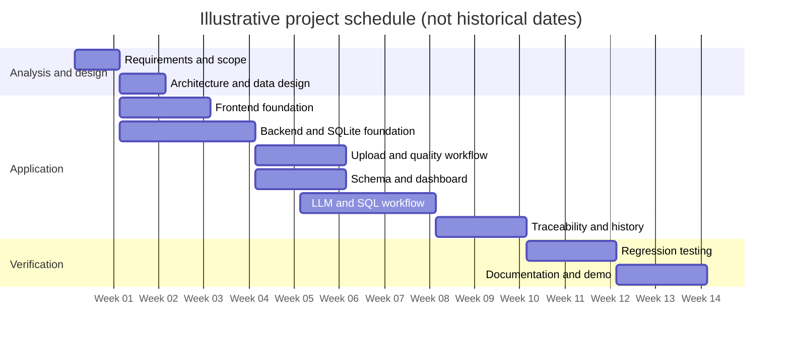
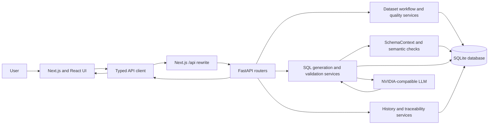
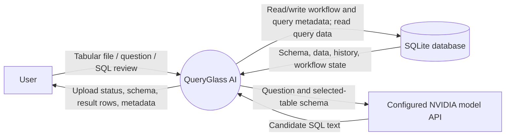
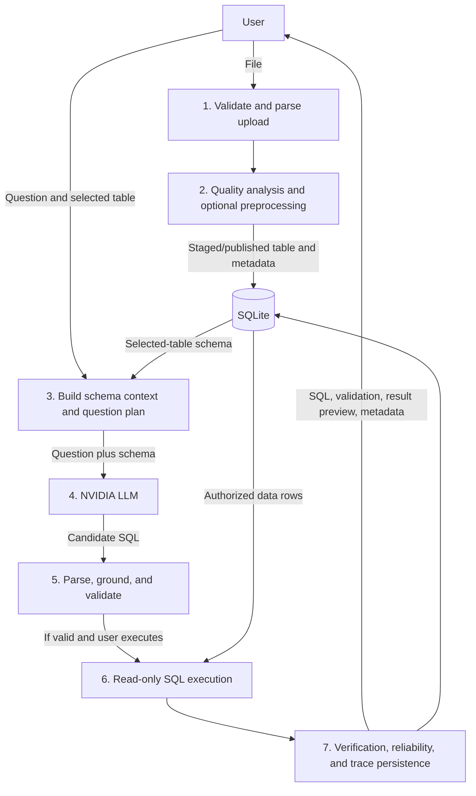
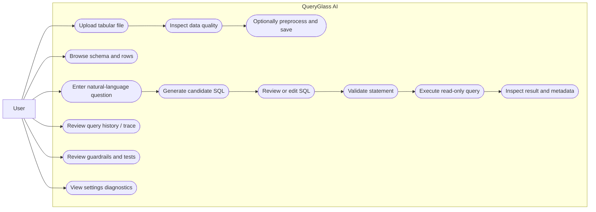
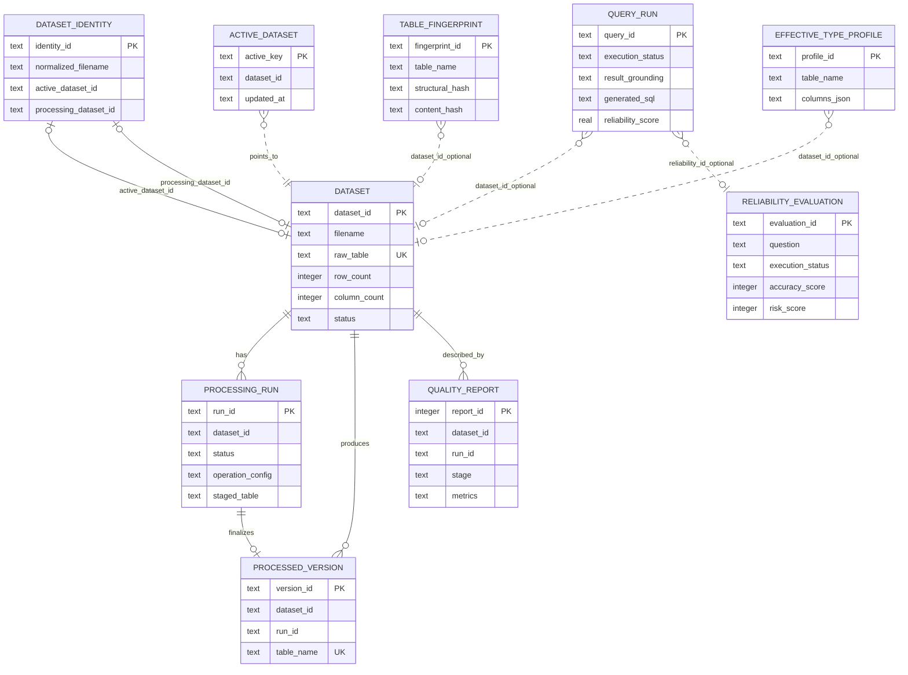
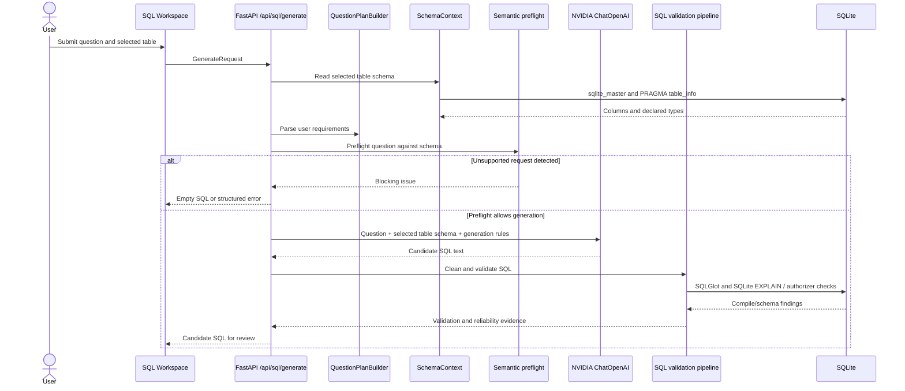
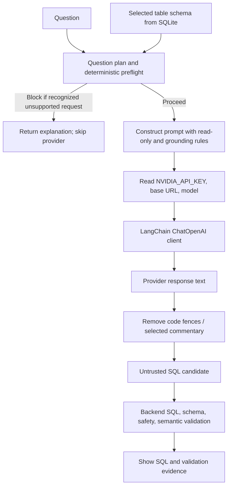
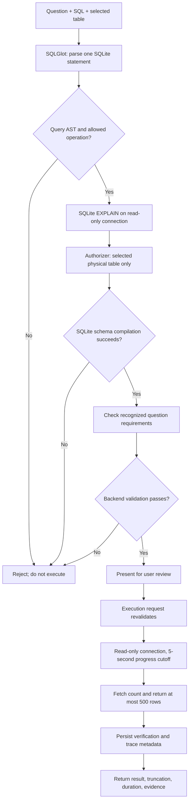

# QueryGlass AI
## An Intelligent LLM-Powered Natural Language to SQL Platform

### Complete Technical Project Documentation

**Academic programme:** B.Tech. Information Technology  
**Project category:** Minor Project (IT452)  
**Institution:** CHARUSAT — [INFORMATION REQUIRED: constituent institute name]  
**Academic year / semester:** [INFORMATION REQUIRED]  
**Candidate name:** [INFORMATION REQUIRED]  
**Enrollment number:** [INFORMATION REQUIRED]  
**Project guide:** [INFORMATION REQUIRED]  
**Submission date:** [INFORMATION REQUIRED]  
**Repository audit date:** 25 November 2026

> **Document status.** This report describes the source code and tests available in the repository at the audit date. It does not claim that provider-backed generation was exercised against a live NVIDIA service or that the application was deployed. Where personal, institutional, historical, or deployment facts are not in the repository, they remain explicit placeholders.

---

## Candidate Declaration

I, **[CANDIDATE NAME]**, Enrollment No. **[ENROLLMENT NUMBER]**, declare that the project entitled **“QueryGlass AI: An Intelligent LLM-Powered Natural Language to SQL Platform”** is submitted in partial fulfilment of the requirements for the B.Tech. Information Technology Minor Project (IT452) at **[INSTITUTE NAME]**, CHARUSAT.

The implementation and repository-grounded technical account in this document are presented to the best of my knowledge. Any external sources used are listed in the references. This declaration must be reviewed and completed by the candidate before submission.

**Candidate signature:** ____________________  
**Date:** [INFORMATION REQUIRED]  
**Place:** [INFORMATION REQUIRED]

---

## Certificate

This is to certify that the project entitled **“QueryGlass AI: An Intelligent LLM-Powered Natural Language to SQL Platform”**, submitted by **[CANDIDATE NAME]** (Enrollment No. **[ENROLLMENT NUMBER]**) in partial fulfilment of the B.Tech. Information Technology Minor Project (IT452), is work carried out under my supervision at **[INSTITUTE NAME]**, CHARUSAT, during **[ACADEMIC YEAR]**.

**Project Guide:** [NAME, DESIGNATION]  
**Signature:** ____________________  
**Head of Department:** [NAME / DESIGNATION]  
**Signature:** ____________________  
**Date and institutional seal:** [INFORMATION REQUIRED]

> This is a formatting template, not a verified institutional certificate. Obtain the approved wording and signatures from the department.

---

## Abstract

QueryGlass AI is a local web application for exploring tabular data and generating candidate SQLite queries from natural-language questions. A user imports a CSV, XLS, or XLSX file. The backend parses the file into a pandas DataFrame, calculates data-quality metrics, and publishes a workflow-managed table in SQLite. The user can inspect the live table schema and optionally preprocess a copy while retaining the raw upload.

In the SQL workspace, the user selects a table and submits a question. The backend reads the selected table's schema, builds a question plan, performs deterministic preflight checks, and—when configured—sends the question and schema to NVIDIA's OpenAI-compatible API through LangChain's `ChatOpenAI` integration. Candidate SQL is parsed and checked with SQLGlot, SQLite compilation, schema grounding, a selected-table read authorizer, and pattern-based semantic checks. The user can review and edit the SQL. Execution revalidates the statement and runs it against a read-only SQLite connection, returning at most 500 preview rows together with execution and verification metadata.

The application also provides a dashboard, schema explorer, query history, guardrails and reliability views, settings diagnostics, and persistent query-run traceability. The backend regression suite passed 91 tests in the repository environment; frontend TypeScript checking, ESLint, and a production build also passed during this audit. These results establish test execution outcomes only. They are not measurements of natural-language-to-SQL accuracy. Semantic checks are partial heuristics, reliability scores are engineering indicators rather than calibrated probabilities, and no separate natural-language answer is generated from query results.

**Keywords:** Natural Language to SQL, LLM, SQLite, FastAPI, Next.js, SQL validation, data quality, query traceability.

---

## Acknowledgement

I would like to express my gratitude to **[PROJECT GUIDE NAME]**, **[DEPARTMENT / INSTITUTE]**, and **[OTHER CONTRIBUTORS, IF APPLICABLE]** for their guidance and support during this project. I also acknowledge the maintainers of the open-source libraries and documentation cited in this report.

> Personal acknowledgements are intentionally left for the candidate to complete.

---

## List of Figures

| Figure | Title |
|---|---|
| 1 | High-level system architecture |
| 2 | Level 0 data-flow diagram |
| 3 | Level 1 data-flow diagram |
| 4 | User use-case flow |
| 5 | Logical database entity-relationship diagram |
| 6 | Natural-language-to-SQL generation sequence |
| 7 | AI model integration workflow |
| 8 | SQL validation and execution workflow |
| 9 | Frontend-backend communication |
| 10 | Illustrative project work schedule |

## List of Tables

| Table | Title |
|---|---|
| 1 | Technology and declared versions |
| 2 | Functional requirements |
| 3 | Non-functional requirements and evidence |
| 4 | Project deliverables |
| 5 | Illustrative project schedule |
| 6 | Application modules |
| 7 | Application-managed SQLite tables |
| 8 | HTTP API reference |
| 9 | Backend test suites and coverage themes |
| 10 | Representative test-case outcomes |
| 11 | Screenshot capture inventory |
| 12 | Repository audit summary |

## Table of Contents

- [Front matter](#queryglass-ai)
- [Chapter 1: Introduction](#chapter-1-introduction)
  - [1.1 Overview](#11-overview)
  - [1.2 Problem Definition](#12-problem-definition)
  - [1.3 Motivation](#13-motivation)
  - [1.4 Objectives and Scope](#14-objectives-and-scope-of-the-project)
  - [1.5 Tools and Technologies](#15-tools-and-technologies-used)
- [Chapter 2: Project Management](#chapter-2-project-management)
  - [2.1 Project Planning](#21-project-planning)
  - [2.2 Development Approach](#22-project-development-approach-and-justification)
  - [2.3 Work Scheduling](#23-project-work-scheduling)
- [Chapter 3: System Analysis and Design](#chapter-3-system-analysis-and-design)
  - [3.1 Existing System](#31-existing-system-and-its-limitations)
  - [3.2 Proposed System](#32-proposed-system-overview)
  - [3.3 System Requirements](#33-system-requirements)
  - [3.4 System Design](#34-system-design)
    - [3.4.1 System Architecture](#341-system-architecture)
    - [3.4.2 Data-Flow Diagrams](#342-data-flow-diagrams)
    - [3.4.3 Use-Case Design](#343-use-case-design)
    - [3.4.4 Database Design](#344-database-design)
    - [3.4.5 AI and SQL Processing Architecture](#345-ai-and-sql-processing-architecture)
    - [3.4.6 SQL Validation and Execution Design](#346-sql-validation-and-execution-design)
  - [3.5 Technology Stack](#35-technology-stack)
- [Chapter 4: System Implementation and Testing](#chapter-4-system-implementation-and-testing)
  - [4.1 Module Description](#41-module-description)
    - [4.1.1 Dashboard](#411-dashboard-module)
    - [4.1.2 Upload and Dataset Import](#412-file-upload-and-dataset-import-module)
    - [4.1.3 Data Quality and Preprocessing](#413-data-quality-and-preprocessing-module)
    - [4.1.4 Schema Explorer](#414-schema-explorer-module)
    - [4.1.5 Natural Language to SQL](#415-natural-language-to-sql-module)
    - [4.1.6 SQL Validation and Guardrails](#416-sql-validation-and-guardrails-module)
    - [4.1.7 SQL Execution](#417-sql-execution-module)
    - [4.1.8 Reliability and Result Metadata](#418-reliability-and-result-metadata-module)
    - [4.1.9 Query History](#419-query-history-module)
    - [4.1.10 Settings](#4110-settings-module)
  - [4.2 Coding Standards](#42-coding-standards-and-practices)
  - [4.3 Implementation Details](#43-implementation-details)
    - [4.3.1 Frontend](#431-frontend-implementation)
    - [4.3.2 Backend](#432-backend-implementation)
    - [4.3.3 Database](#433-database-implementation)
    - [4.3.4 AI Model Integration](#434-ai-model-integration)
    - [4.3.5 SQL Workflow](#435-sql-generation-and-validation-workflow)
    - [4.3.6 Security](#436-security-implementation)
    - [4.3.7 API Reference](#437-api-implementation)
    - [4.3.8 Complete Workflow](#438-complete-system-workflow)
  - [4.4 Testing and Results](#44-testing-and-results)
  - [4.5 Result Analysis](#45-result-analysis)
- [Chapter 5: Conclusion and Future Work](#chapter-5-conclusion-and-future-work)
- [References](#references)
- [Repository Audit Summary](#repository-audit-summary)
- [Screenshot Inventory](#screenshot-capture-inventory)
- [Information Required from the Student](#information-required-from-the-student)

---

# Chapter 1: Introduction

## 1.1 Overview

### 1.1.1 Project overview

QueryGlass AI is a web-based data exploration and SQL assistance application. Its core use case is to let a user ask a question about a selected tabular dataset in ordinary language, obtain a candidate SQLite `SELECT` statement, inspect the validation evidence, and execute the statement under backend-enforced read-only restrictions. It also supports file import, data-quality inspection, optional preprocessing, live schema exploration, query history, and query-run traceability.

The project is implemented as a Next.js frontend and a Python FastAPI backend. SQLite is the application and imported-data store. The language model is accessed through NVIDIA's OpenAI-compatible endpoint using LangChain `ChatOpenAI`. The application is designed around one selected physical table per query; although the model prompt mentions joins among available SQL constructs, SQLite authorization prevents reading a second physical table.

### 1.1.2 Natural Language to SQL

Natural Language to SQL (NL-to-SQL) is the task of translating a question expressed in a human language into a database query. For example, “Count the records in this table” may be represented by `SELECT COUNT(*) FROM selected_table`. Real questions can include filters, requested output columns, grouping, sorting, aggregation, and implicit assumptions. A syntactically valid SQL statement may still omit a requested condition or compute the wrong business meaning.

QueryGlass AI therefore treats generated SQL as a candidate, not as trusted output. It includes schema grounding, SQL parsing and compilation, deterministic checks for a subset of recognized requirements, read-only authorization, explicit user review, and execution metadata. None of these mechanisms proves that every question has been understood correctly.

### 1.1.3 Why NL-to-SQL can be useful

Users who do not write SQL routinely may benefit from expressing an analytical request in ordinary language and reviewing a proposed query instead of authoring the whole statement manually. NL-to-SQL can also make database schemas easier to approach when paired with a schema browser. Its usefulness depends on clear questions, correct schema context, SQL validation, appropriate data access, and human review for ambiguous or high-impact results.

### 1.1.4 High-level operation

1. A user imports a CSV or Excel workbook from Schema Explorer.
2. The backend validates the file name and size, parses the contents, profiles quality, and stores a staged table.
3. A transaction publishes a sanitized raw table and updates the workflow registry and active-dataset pointer.
4. The user inspects the table and may run optional preprocessing on a copy.
5. In SQL Workspace, the user selects a table and enters a question.
6. Backend question planning and semantic preflight can block a recognizable unsupported request.
7. If generation proceeds, the server sends the question and selected-table schema to the configured NVIDIA model.
8. The candidate SQL is cleaned and validated. The UI presents it for review and editing.
9. On execution, the backend validates again and runs the query read-only against the selected table.
10. The frontend displays result rows and verification, reliability, and execution metadata.

### 1.1.5 Role of AI and large language models

The LLM proposes SQL based on the user question and supplied schema. It does not receive authority to execute SQL and is not treated as a security control. SQL generation is provider-dependent and requires a server-side `NVIDIA_API_KEY`. Deterministic validation and SQLite authorizer controls run on the backend, independent of model compliance. The application does not currently generate a separate, model-written answer explaining the values in the result.

## 1.2 Problem Definition

The project addresses practical friction when working with tabular databases:

| Problem | Relevance to the application | Implemented response and boundary |
|---|---|---|
| SQL syntax knowledge is needed for direct querying | Some users can describe an analytical goal more naturally than write SQL | Workspace accepts a question and requests candidate SQL. Generation still depends on provider availability and may be semantically wrong. |
| Users may not know table and column names | An unknown schema makes query writing error-prone | Schema Explorer and Workspace retrieve live SQLite table/column metadata; question planning can identify some missing objects. |
| Manual queries can contain syntax or schema errors | Invalid SQL wastes time and can fail at runtime | SQLGlot, SQLite `EXPLAIN`, and schema validation catch many syntax and object-reference failures. |
| Database mutation and unauthorized access are concerns | Generated or edited SQL must not be blindly executed | The execution path allows one read-only query and installs a SQLite authorizer scoped to the selected physical table. |
| Natural-language requirements can be omitted or misinterpreted | A query can compile and still answer the wrong question | Pattern-based semantic checks detect selected omissions and contradictions; this is partial, not general language understanding. |
| Imported data may contain quality problems | Missing values, duplicates, inconsistent types, and outliers can affect analysis | The upload workflow reports quality metrics and exposes optional preprocessing. The system does not automatically clean raw uploads. |

The implemented solution provides assistance and guardrails around the query workflow; it does not eliminate the need for review or guarantee a correct analytical answer.

## 1.3 Motivation

The intended practical motivation is to reduce the effort required to move from a tabular data file to an inspectable SQL query. The codebase combines import and quality review with a workspace where a user can choose the target table, generate SQL, validate it, and execute it without allowing data-changing SQL through that execution route. Query history and traceability are included to make prior query outcomes easier to inspect.

Potential users include analysts, students, and developers working with local tabular data. The repository does not establish a formal user study, deployment population, or measured productivity improvement; such claims are not made here.

## 1.4 Objectives and Scope of the Project

### Primary objectives

- Import CSV, XLS, and XLSX data into the configured SQLite database.
- Inspect imported tables, columns, declared types, and data-quality indicators.
- Accept natural-language questions about a selected table.
- Generate candidate SQLite SQL using the configured NVIDIA-compatible LLM endpoint.
- Validate syntax, selected-table schema access, read-only behavior, and a limited set of semantic requirements.
- Execute an approved statement with database-side authorization, timeout cutoff, and bounded result preview.
- Persist query execution, validation, reliability, and result-verification metadata.

### Secondary objectives

- Provide a dashboard of database, dataset, and history information.
- Support optional preprocessing while retaining raw uploaded data.
- Offer a query history and reliability test center.
- Record table fingerprints and effective-type profiles for traceability.
- Surface limitations and validation findings in the interface.

### Functional scope

The implemented user-facing areas are Dashboard, SQL Workspace, Schema Explorer, Query History, Guardrails, and Settings. Additional backend endpoints expose upload workflow detail, data export, hallucination analysis, reliability tests, and query-run reports.

### Technical scope

- **Input data:** CSV, XLS, XLSX. Parsing is DataFrame-based and occurs in memory.
- **Database:** SQLite, with a canonical `database.db` at the project root unless the source configuration is changed.
- **Query operation:** single read-only SELECT-family query over one selected physical table. CTEs, subqueries, aliases, aggregation, window functions, and derived relations are accepted when validated; another physical table is not authorized.
- **AI:** provider-backed candidate SQL generation through NVIDIA's OpenAI-compatible API. No provider-backed live result was tested in this audit.
- **Security:** backend SQL restrictions and upload validation are implemented, but authentication and per-user authorization are absent.
- **Result:** at most 500 rows returned as a preview. The server fetches further rows to establish total result count and truncation metadata.

### Current limitations

Semantic analysis is pattern-based; multi-table querying is not supported by the selected-table authorizer; there is no natural-language answer synthesis; scores are not calibrated accuracy probabilities; provider success depends on network, key, model availability, and external service; upload job state is in-process; and there is no authentication or user/tenant data isolation.

## 1.5 Tools and Technologies Used

The table gives the manifest declaration, not a guarantee about the installed version on every machine. Python is not pinned in a runtime-version file. The frontend build reported Next.js 15.5.28 at audit time, which is an installed resolution within the declared `^15.5.6` range; the manifest remains the reproducible source declaration.

### Table 1. Technology and declared versions

| Area | Technology | Declared version / constraint | Purpose |
|---|---|---:|---|
| Frontend | Next.js | `^15.5.6` | App Router, page rendering, production build, same-origin API rewrites |
| Frontend | React / React DOM | `^19.1.1` | UI composition and browser interaction |
| Frontend | TypeScript | `^5.7.2` | Typed frontend source and API contracts |
| Frontend | `@uiw/react-codemirror` | `^4.25.1` | Embedded SQL editor |
| Frontend | `@codemirror/lang-sql` | `^6.8.0` | SQL language support in the editor |
| Frontend | Recharts | `^2.15.4` | Dashboard activity chart |
| Frontend | lucide-react | `^0.468.0` | Interface icons |
| Frontend quality | ESLint | `^9.17.0` | JavaScript/TypeScript linting |
| Backend | Python | Not pinned in repository | Backend implementation language |
| Backend | FastAPI | `>=0.115.0` | HTTP API and request validation |
| Backend | Uvicorn `[standard]` | `>=0.30.0` | ASGI server |
| Backend | Pydantic | Transitive / not separately pinned | Request, response, and traceability data models |
| AI integration | LangChain | `==1.3.15` | Model orchestration framework |
| AI integration | langchain-core | `==1.6.0` | Prompt template and message abstractions |
| AI integration | langchain-openai | `>=0.3.0` | OpenAI-compatible NVIDIA chat endpoint client |
| AI model | NVIDIA endpoint; default `mistralai/mistral-large-4-1t-a52b` | Environment-overridable; no SDK version | Candidate SQL generation |
| Database | SQLite (`sqlite3`) | Python standard library; SQLite runtime version varies | Persistent imported tables and application metadata |
| SQL validation | SQLGlot | `>=19.0.0` | SQLite SQL parsing, AST inspection, and operation checks |
| Data processing | pandas | `==3.0.5` | File parsing, profiling, preprocessing, SQLite table writing |
| Data processing | NumPy | `==2.5.2` | Numeric profiling and outlier operations |
| File support | openpyxl | `>=3.1.5` | XLSX reading |
| File support | xlrd | `>=2.0.1` | Legacy XLS reading |
| Configuration | python-dotenv | `>=1.0.0` | Loading root `.env` values |
| Upload API | python-multipart | `>=0.0.9` | Multipart file uploads |
| Testing | pytest | `>=9.0.0` | Backend test runner |
| Frontend quality | TypeScript compiler | `^5.7.2` | `npm run typecheck` |

Python constraints are in [requirements.txt](requirements.txt) and duplicated in [backend/requirements.txt](backend/requirements.txt). Frontend dependencies and scripts are in [frontend/package.json](frontend/package.json). Runtime values are read in [backend/config.py](backend/config.py).

### Technology rationale

- **Next.js and React** organize the browser application into route wrappers and a shared view component. The App Router exposes the six application screens.
- **TypeScript** gives the UI typed API response interfaces and checks component usage at build time.
- **FastAPI and Pydantic** provide JSON and multipart endpoints, field bounds, typed request parsing, and HTTP error responses.
- **SQLite** is a local embedded database that stores imported tables and application metadata without requiring a separately managed database server.
- **pandas and NumPy** support tabular parsing and in-memory data-quality/preprocessing operations.
- **SQLGlot and SQLite compilation** provide complementary SQL checks: SQLGlot examines the statement structure, while SQLite `EXPLAIN` checks SQLite's parser/compiler and resolves schema references.
- **LangChain `ChatOpenAI`** sends the schema-grounded generation prompt to the configured OpenAI-compatible NVIDIA endpoint. It is not a substitute for server-side validation.
- **pytest, ESLint, and TypeScript** provide the automated quality checks available in the repository. No frontend unit-test runner or browser E2E suite is declared.

---

# Chapter 2: Project Management

## 2.1 Project Planning

The repository contains implementation code and test evidence but no authoritative project charter, dated work log, approved requirements document, or historical schedule. Consequently, the stages below describe a reasonable project organization for this implementation and are not represented as a verified record of how work was performed.

### 2.1.1 Major Planning Activities

1. **Requirement collection:** identify the workflow from file import through query execution, with status and limitation reporting.
2. **Requirement analysis:** distinguish user-facing capabilities from backend security boundaries and provider-dependent behaviors.
3. **Technology selection:** use Next.js/React for the UI, FastAPI for APIs, SQLite for storage, and a provider-backed chat model for SQL proposals.
4. **Architecture design:** separate frontend pages, API adapters, domain services, persistence helpers, and SQLite metadata.
5. **Frontend development:** build dashboard, workspace, schema, history, guardrails, and settings views.
6. **Backend development:** implement API routes, file processing, SQL validation/execution, query history, and workflow state.
7. **AI integration:** construct a schema-grounded prompt and configure NVIDIA endpoint/model through server environment variables.
8. **Database integration:** stage uploads, publish data transactionally, and persist workflow, reliability, and traceability records.
9. **Testing and debugging:** exercise backend unit/integration behavior, frontend type checking, linting, and production compilation.
10. **Documentation and final integration:** audit source behavior, document limits, and prepare evidence and screenshots for academic submission.

### 2.1.2 Project Deliverables

#### Table 4. Project deliverables

| Deliverable | Repository evidence | Status |
|---|---|---|
| Web application frontend | `frontend/app`, `frontend/components`, `frontend/lib` | Implemented |
| FastAPI backend | `backend/main.py`, `backend/api`, `backend/services` | Implemented |
| Dataset import and processing | File loader, quality profiler, dataset workflow, upload jobs | Implemented |
| SQL generation and guardrails | SQL engine, semantic reliability checks, API routes | Implemented; provider-backed run requires credentials |
| SQLite metadata and migrations | `database/app_tables.sql`, `backend/db/migrations` | Implemented |
| Automated backend tests | `backend/tests` | 91 passed in this audit |
| Frontend quality checks | npm scripts in `frontend/package.json` | Typecheck, lint, and build passed in this audit |
| Academic report source | This Markdown file | Prepared from repository evidence; student placeholders remain |
| Application screenshots | No screenshot files were included in the audited project tree | Not captured; see screenshot inventory |
| Institutional forms and signed approval | Not present in repository | Requires student/department input |

## 2.2 Project Development Approach and Justification

No source or project artifact establishes a named historical methodology such as Scrum, Waterfall, or a formally managed Agile process. For project-report presentation, an **iterative and incremental approach is suitable as a proposed description**, not a verified historical claim. The increments can be described as: (1) data import and schema inspection, (2) query generation and validation, (3) execution and history, (4) reliability/traceability, and (5) interface and quality improvements.

This approach is suitable because import, schema, generation, and execution are separable capabilities with integration points that can be tested independently. Incremental delivery also supports testing policy boundaries—such as table authorization—before exposing execution in the UI. The statement describes an appropriate project-management model; the candidate should amend it if dated project records establish a different process.

## 2.3 Project Work Scheduling

There are no verified historical dates in the repository. The following schedule is illustrative, relative to a hypothetical project start; it must not be presented as the actual work history unless confirmed by the candidate.

#### Table 5. Illustrative project schedule

| Activity | Illustrative duration | Dependency |
|---|---:|---|
| Requirements and scope analysis | Week 1 | — |
| Architecture and database design | Week 2 | Requirements |
| Frontend shell and navigation | Weeks 2–3 | Architecture |
| Backend API and SQLite foundation | Weeks 2–4 | Architecture |
| File upload and quality workflow | Weeks 4–5 | Backend/database |
| Schema explorer and dashboard | Weeks 4–6 | Data workflow |
| LLM integration and prompt design | Weeks 5–6 | Schema API |
| SQL validation, guardrails, execution | Weeks 6–8 | SQL generation foundation |
| Query history and reliability traceability | Weeks 8–9 | Execution workflow |
| Regression testing and debugging | Weeks 9–10 | Integrated modules |
| Documentation and demonstration preparation | Weeks 10–11 | Verification |

### Figure 10. Illustrative project work schedule

The chart uses an arbitrary baseline solely to render illustrative weeks; the dates are not historical project dates.



---

# Chapter 3: System Analysis and Design

## 3.1 Existing System and Its Limitations

Traditional database analysis commonly uses a database client, spreadsheet, or application form. SQL gives precise control over projections, filters, aggregation, joins, and ordering, but users must know the schema and syntax. Manual query authoring can introduce syntax, column-reference, and logic errors.

NL-to-SQL research explores mapping questions to executable database queries, including cross-domain and complex-query tasks. The difficulty is not only generating syntax: the system must map language to the correct schema, preserve all requested constraints, handle ambiguity, and avoid unsafe operations. Research benchmarks and methods in the references provide context; this report makes no unsupported comparison with commercial products or other systems.

QueryGlass AI addresses part of this workflow by pairing model-generated candidate SQL with schema inspection, deterministic validation, execution controls, and visible result metadata. Its limitations are material: the semantic checker covers recognizable patterns rather than all language, and the current query authorization prevents cross-table access.

## 3.2 Proposed System Overview

The system has a browser frontend, a same-origin API proxy, a FastAPI backend, service modules, SQLite persistence, and an external NVIDIA-compatible model endpoint.

The implemented workflow is:

1. **Import:** multipart file is received through `/api/datasets/upload-jobs` (the current UI path) or the synchronous `/api/datasets/upload` endpoint.
2. **Validate and parse:** backend checks extension and byte limit; `load_file` parses CSV/XLS/XLSX into a pandas DataFrame and trims headers.
3. **Profile and stage:** quality metrics are calculated and data are written to a staging table.
4. **Publish:** a database transaction renames/publishes the raw table, stores workflow metadata, and points to the active dataset.
5. **Inspect / preprocess:** the user views live schema and may run a separately tracked preprocessing operation; saving a processed result is a separate action.
6. **Build query context:** backend resolves the chosen table and reads columns and declared types.
7. **Plan and preflight:** `QuestionPlanBuilder` and `semantic_validate` can reject some unsupported requests before provider invocation.
8. **Generate:** if configured, the LLM receives question, table name, and selected-table schema. Its output is cleaned but remains untrusted.
9. **Validate:** SQLGlot parsing, read-only classification, SQLite `EXPLAIN`, authorizer-based schema resolution, grounding, and semantic heuristics run.
10. **Execute:** `/api/sql/execute` revalidates and runs a single authorized read-only statement. The result is capped to 500 displayed rows; the response includes row totals/truncation and verification metadata.
11. **Trace:** query-run and reliability persistence retain execution and evidence fields separately from legacy query history.

The database is an existing SQLite file that is created/initialized when the application writes to it; the code does not create a new database server. Imported tables are dynamic and have schemas derived from uploaded data.

### Figure 1. High-level system architecture

The diagram distinguishes the provider's role as SQL proposer from the backend validation/execution boundary.



### Figure 2. Level 0 data-flow diagram

The system accepts user files and questions, returns previews and query results, and exchanges schema-grounded generation requests with an external model provider. No direct browser-to-database connection exists.



### Figure 3. Level 1 data-flow diagram

The upload path and query path share SQLite but have distinct responsibilities. The provider is invoked only during generation, while validation and execution remain server-side.



### 3.2.1 Use-case design

The repository presents one unauthenticated user experience, not distinct authenticated roles. The “User” below is a functional actor and does not imply access control. Provider and local database are external/system dependencies.

### Figure 4. User use-case flow



## 3.3 System Requirements

### 3.3.1 Functional Requirements

#### Table 2. Functional requirements

| ID | Requirement | Implementation evidence | Status |
|---|---|---|---|
| FR-01 | Accept CSV, XLS, and XLSX uploads | `file_loader.load_file`; schema upload routes | Implemented |
| FR-02 | Enforce supported extension and configured upload-size limit | `backend/main.py` upload handlers; `backend/config.py` | Implemented |
| FR-03 | Report dataset dimensions, sample values, and quality metrics | `inspect_dataset`, `analyze_quality`, workflow reports | Implemented |
| FR-04 | Store raw upload and active dataset metadata | `dataset_workflow.ingest_upload` | Implemented |
| FR-05 | Offer optional configurable preprocessing and processed-version storage | `preprocess_dataframe`, workflow run/finalize | Implemented |
| FR-06 | Enumerate tables and inspect schema, indexes, keys, and rows | dataset schema/row API and SQLite PRAGMAs | Implemented |
| FR-07 | Accept question and selected table for SQL generation | `GenerateRequest`, `/api/sql/generate` | Implemented; live generation provider-dependent |
| FR-08 | Ground generation prompt in selected-table schema | `SchemaContext.to_schema_text`; `generate_sql` | Implemented |
| FR-09 | Validate SQL syntax, operation, schema, and selected semantic requirements | `_validate`, SQLGlot, SQLite compilation, semantic validator | Implemented partially for semantics |
| FR-10 | Execute only backend-approved read-only SQL | `execute`, `_run_readonly` | Implemented |
| FR-11 | Bound query result preview to 500 rows and report truncation | `_run_readonly`, execution response | Implemented |
| FR-12 | Present returned data and execution metadata | Workspace UI and execution API | Implemented |
| FR-13 | Persist query history, reliability evaluations, and query-run trace | history, reliability, and query-run persistence services | Implemented |
| FR-14 | Provide dashboard, history, guardrails, and settings views | `AppView` plus App Router pages | Implemented |
| FR-15 | Produce a natural-language answer synthesized from result rows | No such answer-synthesis endpoint found | Not implemented |
| FR-16 | Authenticate users and authorize datasets per identity | No authentication/authorization layer found | Not implemented |
| FR-17 | Query multiple physical tables with verified relationships | Selected-table authorizer denies other physical table reads | Not implemented |

### 3.3.2 Non-Functional Requirements

#### Table 3. Non-functional requirements and evidence

| Attribute | Current evidence | Status / desired extension |
|---|---|---|
| Performance | Upload parsing and quality analysis use in-memory DataFrames; insertion is chunked; SQL uses a progress handler and result preview limit | Some resource bounds implemented; no production benchmark or 187,531 × 21 benchmark |
| Usability | Six application pages, schema explorer, editor, notices, bounded previews | Implemented; no formal usability study |
| Reliability | Dataset publication is transactional; state and trace data are persisted; 91 backend tests pass | Implemented at code/test level; provider availability and deployment recovery are external |
| Security | Read-only SQLite execution, authorizer, statement checks, API key server-side, upload validation | Partial: no authentication, user isolation, general rate limiting, or full resource governance |
| Maintainability | Routers, services, schemas, persistence helpers, TypeScript API types | Modular separation is present; no documented formatter or static Python type-check command |
| Scalability | Chunked SQLite writes and upload job worker exist | Limited: whole-file DataFrames, one in-process worker, no distributed queue or multi-tenant database design |
| Data integrity | Transactional staging/publish and separate raw/processed workflow states | Implemented for managed dataset lifecycle; application metadata references are not enforced foreign keys |
| Observability | Request logging, test reports, query trace persistence | Partial: no request correlation IDs, deployment monitoring, alerting, or documented log-retention policy |

## 3.4 System Design

### 3.4.1 System architecture

#### Frontend layer

The Next.js App Router exposes `/dashboard`, `/workspace`, `/schema`, `/history`, `/guardrails`, and `/settings`. The route files are thin wrappers; most state and user actions reside in `frontend/components/AppView.tsx`. `frontend/lib/api.ts` performs same-origin requests, translates network and HTTP errors to `ApiError`, and `frontend/next.config.ts` rewrites `/api/*` to the configured backend origin.

#### API layer

`backend/api/*.py` contains FastAPI router adapters for health, dashboard, schema, SQL, history, reliability, and settings. The actual operation handlers are largely in `backend/main.py`. Pydantic models constrain question, SQL, table name, and reliability-test request sizes.

#### Service layer

Services implement file loading, data quality analysis, dataset workflow transitions, upload-job management, SQL generation and validation, reliability scoring, result verification, table fingerprinting, effective-type profiling, and query-run persistence.

#### Persistence layer

`backend/db/session.py` manages SQLite helpers and legacy history functions. `backend/db/migrations.py`, SQL migration files, `database/app_tables.sql`, and workflow/persistence services create and extend application metadata. Imported user tables are created dynamically.

#### AI provider layer

`sql_engine.generate_sql` constructs a prompt and invokes the NVIDIA-compatible chat API through LangChain. The provider returns candidate SQL text only; the backend performs its own subsequent checks.

### 3.4.2 Data-Flow Diagrams

The level 0 and level 1 data-flow diagrams are shown as Figures 2 and 3 in Section 3.2. They distinguish user inputs and outputs, the QueryGlass application processes, SQLite data stores, and the external model provider. The diagrams reflect the actual frontend-to-backend route and do not imply direct browser database access.

### 3.4.3 Use-Case Design

The use-case-style flow is shown as Figure 4 in Section 3.2. The implemented application exposes one unauthenticated user role. No administrator, tenant, or role-based actor is defined by the repository.

### 3.4.4 Database Design

The canonical database location defaults to the project root `database.db`. SQLite connection access is provided by Python's standard-library `sqlite3`. Uploaded data are stored as dynamically named tables; application metadata uses `_queryglass_`-prefixed tables. The exact runtime schema can differ as migrations apply and as users upload different files.

#### Table 7. Application-managed SQLite tables

| Table | Main fields / purpose | Key / relationship notes |
|---|---|---|
| `_queryglass_history` | Legacy record fields: ID, timestamp, question, SQL, status, row count, execution time, error | `id` integer primary key; current authoritative query history reads query-run records |
| `_queryglass_datasets` | Dataset ID, filename, raw table, timestamps/counts, column metadata, status/error | `dataset_id` primary key; raw table unique |
| `_queryglass_dataset_identities` | Normalized filename and active/processing dataset IDs | `identity_id` primary key; logical IDs, not declared foreign keys |
| `_queryglass_active_dataset` | Active pointer and update timestamp | Singleton-like `active_key` with CHECK |
| `_queryglass_processing_runs` | Options, state, before/after dimensions, staged table, transformations/errors | `run_id` primary key; logically references dataset |
| `_queryglass_processed_versions` | Stored processed table, counts, config, run/dataset IDs | `version_id` primary key; table unique |
| `_queryglass_quality_reports` | Stage, metrics JSON, dataset/run IDs, timestamp | Integer report primary key |
| `_queryglass_reliability_history` | Question, SQL, provider model, validation, score, execution metadata | `evaluation_id` primary key; reliability events separate from execution traces |
| `_queryglass_query_runs` | Question, generated/executed SQL, status, grounding, evidence JSON, scores, timing and trace metadata | `query_id` primary key; extended by migrations/additive repair |
| `_queryglass_table_fingerprints` | Structural/content hashes, columns and sample signature | Unique table/dataset pair; sampled content hash is not full content proof |
| `_queryglass_effective_types` | Per-column effective-type profile JSON and timestamp | Unique table/dataset pair |

The query-run table includes traceability fields such as `dataset_id`, `executed_sql`, `question_plan_json`, `fingerprint_hash`, `effective_types_json`, `provider_model`, `truncation_status`, `reliability_id`, `validation_json`, `result_verification_json`, and reliability formula fields added by migrations or compatibility repair. The exact legacy and current history paths are not identical; query-run history is the authoritative execution trace.

Application references between dataset, run, processed version, quality report, active pointer, and query-run entities are logical identifiers. `app_tables.sql` does not declare relational foreign-key constraints for these links. Query-run and reliability stores are separate. The query history does not necessarily preserve result cell values.

### Figure 5. Logical database entity-relationship diagram

Relationships in this diagram are logical ID references, not enforced SQLite foreign keys.



### 3.4.5 AI and SQL Processing Architecture

`SchemaContext` reads the selected table with SQLite metadata and formats column names, declared types, nullability, and primary-key markers for the prompt. `QuestionPlanBuilder` parses the question against this context. A preflight call to `semantic_validate` may block unsupported or missing-object cases before the provider call. Otherwise `generate_sql` invokes the chat model with a prompt requiring one SQLite-compatible, read-only SELECT and schema-grounded columns. `clean_sql_output` removes code fences and selected explanatory lines. `_validate` then performs audit, schema grounding, semantic checks, reliability scoring, fingerprint comparison, and effective-type profile retrieval. The result is not executed until a separate execution request, which validates again.

### Figure 6. Natural-language-to-SQL generation sequence



### Figure 7. AI model integration workflow



The NVIDIA API key, base URL, and model name are loaded from server environment configuration. The default model is `mistralai/mistral-large-4-1t-a52b`; environment overrides are supported. Temperature is set to zero in the client construction. The inspected invocation does not configure an application-level retry or request timeout. The prompt requires SQL-only output and explicitly tells the model not to invent schema objects, values, results, or unsupported relationships. Prompt instructions are not enforcement; the backend validator and authorizer provide the actual restrictions.

### 3.4.6 SQL Validation and Execution Design

SQLGlot parses statements with the SQLite dialect. The code rejects multiple statements and classifies query ASTs. SQLite `EXPLAIN` compiles against a read-only database URI. During schema validation and execution, an authorizer allows reads only from the selected physical table, permits query/select actions, denies other SQLite actions, and denies `load_extension`. Execution uses `mode=ro`, sets `query_only=ON` and `trusted_schema=OFF`, and installs a progress handler. Result handling fetches enough rows to identify truncation and returns no more than 500 preview records.

Semantic checks extract a subset of requirements from the question, such as recognizable columns, numeric comparisons, output fields, aggregate, grouping, ranking, hypothetical denominators, and selected unsupported diagnosis or injection patterns. Unsupported or ambiguous language may pass without being fully understood; a valid query is not proof of answer correctness.

### Figure 8. SQL validation and execution workflow



## 3.5 Technology Stack

The stack is summarized in Table 1. The technologies work together as follows: Next.js sends typed frontend requests through its rewrite proxy; FastAPI validates JSON and multipart input; service functions process datasets and SQL; SQLite stores data and traces; SQLGlot and SQLite compilation check query structure; and the NVIDIA endpoint proposes SQL that must still pass backend checks. pandas/NumPy operate on imported data in process memory. pytest and frontend scripts validate behavior and buildability.

---

# Chapter 4: System Implementation and Testing

## 4.1 Module Description

The main implementation modules are summarized below. “Status” refers to the current source behavior, not to an assertion of production readiness.

### Table 6. Application modules

| Module | Purpose | Input → output | Main implementation |
|---|---|---|---|
| Dashboard | Summarize DB, dataset, query history | API state → metrics and activity | `AppView.tsx`, `backend/main.py:dashboard` |
| Upload and dataset workflow | Parse, profile, publish, and track uploads | Multipart file → raw table and workflow record | `file_loader.py`, `dataset_workflow.py`, `upload_jobs.py` |
| Quality and preprocessing | Measure quality and optionally transform data | DataFrame/options → report and cleaned frame | `data_quality.py` |
| Schema explorer | Show live tables, schema, and bounded rows | Table name → metadata/rows | `backend/main.py:dataset_schema`, `dataset_rows` |
| NL-to-SQL | Convert question + schema to SQL candidate | Question/table → SQL + validation | `sql_engine.py`, `question_plan_builder.py` |
| Validation and guardrails | Assess syntax, schema, operation, safety, semantics | Question/SQL/table → validation evidence | `sql_engine.py`, `reliability.py`, `_validate` |
| Execution | Run approved SQL and bound output | Validated query → rows + metadata | `backend/main.py:_run_readonly`, `execute` |
| Reliability and result verification | Track heuristic dimensions and execution evidence | Validation/result → score/contracts | `reliability.py`, `result_verification_engine.py` |
| Query history and traces | Persist execution and expose reports | QueryRun → SQLite record/API response | `query_run_persistence.py`, `api/history.py` |
| Settings | Show runtime diagnostics | Server settings → status values | `backend/main.py:settings`, Settings UI |
| Frontend API client | Proxy-facing requests and user-visible errors | Request → typed data or `ApiError` | `frontend/lib/api.ts` |

### 4.1.1 Dashboard Module

**Purpose and problem solved.** Dashboard presents a consolidated view of the configured database and recent application activity so the user can determine whether a dataset and service are available.

**Input and processing.** The frontend loads `/api/dashboard`, `/api/datasets`, `/api/history`, `/api/settings`, and `/api/health`. Backend dashboard logic reads SQLite database size/version/tables/row counts, active dataset state, and query history summaries. The activity chart is derived in the browser from history.

**Output.** The page displays database availability, table counts, query counts/status/timing summaries, recent queries, and activity.

**Errors, security, and limitations.** Failed live requests are surfaced through loading/error states; the UI avoids implying unavailable values are successful. Dashboard statistics do not measure model quality. API access itself has no authentication.

**Source:** `frontend/app/dashboard/page.tsx`, `frontend/components/AppView.tsx`, `frontend/components/ActivityChart.tsx`, `backend/api/dashboard.py`, `backend/main.py:dashboard`.

### 4.1.2 File Upload and Dataset Import Module

**Purpose.** Import spreadsheet and delimited data into the local SQLite database for schema exploration and SQL querying.

**Input and processing.**

1. UI accepts `.csv`, `.xls`, and `.xlsx`; backend checks the extension independently.
2. `QUERYGLASS_MAX_UPLOAD_BYTES` controls the size cap; source default is 5 GiB. FastAPI receives an `UploadFile`.
3. The current UI uses an upload-job API. The server copies the stream into a temporary file in chunks and submits processing to an in-process executor.
4. `load_file` reads CSV with pandas `dtype=str` and `keep_default_na=False`; on CSV parse failure it retries with Latin-1 after seeking to the beginning. Excel is read with `dtype=str`. Headers are trimmed.
5. Empty input and duplicate normalized headers are rejected. The workflow computes quality metrics, writes a staging table, and transactionally publishes the raw table and metadata.
6. The job updates stage/row progress when available; the temporary file is removed in a `finally` path.

**Output.** The API returns upload status, generated table name, dimensions, inspection summary, sample preview (bounded to 500), and workflow state.

**Error handling.** Unsupported extensions return 415, size excess 413, parse errors 400, invalid workflow states use workflow-specific HTTP errors, and enqueue/database failures are surfaced as API errors where handled. A one-worker in-process queue limits concurrency; job state is not preserved across API restart.

**Security and limitations.** The backend validates suffix and file size; a filename suffix is not full content-type proof. The entire input is parsed into memory. The original source file is not retained as a permanent archive. Uploads are not isolated by user identity.

**Source:** `backend/api/schema.py`, `backend/main.py:upload_dataset`, `start_upload_job`, `_process_upload_job`, `backend/services/file_loader.py`, `backend/services/dataset_workflow.py`, `backend/services/upload_jobs.py`.

### 4.1.3 Data Quality and Preprocessing Module

**Quality indicators.** `analyze_quality` computes row/column/cell counts; missing cells including null and blank strings; exact duplicate rows and duplicate groups; optional key duplicates; type mismatches/invalid values using dominant inferred types; outlier indicators; constant columns; empty rows and columns; and total issue count. Outliers and constant columns are advisory. The module defines issue-count rules to avoid double counting.

**Preprocessing.** `preprocess_dataframe` works on a copy. Supported operations include whitespace cleanup, missing-value normalization, optional column-name standardization, removing selected columns, categorical normalization, invalid-value strategies (`leave`, `convert_to_null`, `drop_rows`), type conversion, missing-value strategies (`leave`, `drop_rows`, `median`, `mean`, `mode`, `fill_with_value`), duplicate removal, outlier treatment (`leave`, `cap`, `remove_rows`), and optional empty row/column removal. Available options are validated by the workflow layer. The raw upload is preserved; preprocessing and storage of a processed table are separate workflow steps.

**Input/output and errors.** Input is a pandas DataFrame and option dictionary; output is a transformed DataFrame plus a `PreprocessingReport`. Unsupported option values raise validation errors and prevent the workflow from publishing a processed result.

**Security and limitations.** Preprocessing is explicit rather than automatic for raw data. It is full-frame/in-memory. Type inference and outlier detection are heuristics and should be reviewed before using cleaned data for consequential analysis.

**Source:** `backend/services/data_quality.py`, especially `analyze_quality`, `PreprocessingReport`, `preprocess_dataframe`; `backend/services/dataset_workflow.py`.

### 4.1.4 Schema Explorer Module

**Purpose.** Show available user tables and inspect their live schema and bounded rows.

**Processing.** Schema detail functions use SQLite `PRAGMA table_info`, `foreign_key_list`, and `index_list`; the rows endpoint supports bounded pagination and search. Workflow-managed dataset metadata provides upload identity and processing state, while live SQLite remains the source of actual table schema.

**Output.** Table and row counts, column names/types, primary-key/nullability indicators, foreign-key metadata, indexes, type counts, sample rows, workflow status, quality reports, and allowed processing actions.

**Errors, security, limitations.** Missing tables return 404. Row API limits are bounded (maximum 100 per request); the UI uses a smaller page. Delete operations require user confirmation in the UI but there is no soft-delete/recovery feature. The schema page does not itself enforce user authorization.

**Source:** `frontend/components/AppView.tsx`, `backend/api/schema.py`, `backend/main.py:datasets`, `dataset_schema`, `dataset_rows`, `backend/db/session.py:get_table_schema_details`.

### 4.1.5 Natural Language to SQL Module

**Input.** `GenerateRequest` has a required question of 1–2,000 characters and optional table name of 1–100 characters. If table is omitted, the backend resolves the active raw table or a sole unambiguous table; otherwise it returns a selection error.

**Processing.**

1. Resolve table and construct `SchemaContext`.
2. Build a `QuestionPlan` with `QuestionPlanBuilder`.
3. Run semantic preflight. Critical issues may prevent provider invocation.
4. Construct a prompt containing table, physical column names/types, question, SQLite constraints, and no-invention requirements.
5. Instantiate `ChatOpenAI` with server-side key, configured base URL, model, and temperature zero.
6. Invoke the prompt chain, clean markdown fences and selected commentary, and validate generated SQL.
7. Record a reliability evaluation for non-empty SQL.

**Output.** SQL text, resolved table, question plan, validation, reliability report/ID, planning status, and a static explanatory message.

**Error handling.** Missing provider configuration raises a clear generation error and the route maps generation exceptions to 503. Unsupported question plans can return a structured 400; some semantic preflight blocks return an empty SQL response with validation findings. The provider request has no explicit application-level retry or timeout in the inspected code.

**Security and limitations.** The API key remains on the server. The question and schema are sent to the configured external provider. No PII redaction or separate answer synthesis was found. Prompt adherence is not trusted as a security guarantee. Generation is provider-dependent and accuracy is not measured by the passing backend tests.

**Source:** `backend/main.py:generate`, `backend/schemas/sql.py:GenerateRequest`, `backend/services/question_plan_builder.py`, `backend/services/sql_engine.py:generate_sql`, `SchemaContext`.

### 4.1.6 SQL Validation and Guardrails Module

**Purpose.** Reject malformed, mutating, ungrounded, or recognized semantically incomplete SQL before execution.

**Checks.**

- Pydantic validates request fields and length bounds at the HTTP boundary.
- SQLGlot parses using the SQLite dialect and the code rejects multiple statements.
- AST classification accepts query statements and rejects write/DDL/command nodes.
- SQLite `EXPLAIN` on `mode=ro` compiles the SQL against the real schema.
- SQLite authorizer permits reads only from the selected physical table and denies other actions; `load_extension` is denied.
- `semantic_validate` compares SQL with recognized requirements in the natural-language question.
- Fingerprint and effective-type metadata are attached when available.

**Error handling.** Validation output includes `valid`, syntax/schema flags, operation, safety status, error category, reasons, grounding findings, semantic issues, and reliability. Execution revalidates independently; UI validation is not authorization.

**Security limitations.** The authorizer and read-only mode limit the SQL execution boundary, but they do not supply user authentication, resource isolation, complete SQL cost controls, or semantic correctness. The schema policy deliberately blocks multi-table physical joins. Semantic validation is heuristic and incomplete.

**Source:** `backend/main.py:_validate`, `backend/services/sql_engine.py:SQLParser`, `audit_sql`, `validate_sql_grounded`, `backend/services/reliability.py:semantic_validate`.

### 4.1.7 SQL Execution Module

`execute` receives the same core fields as validation plus an optional reliability ID. It calls `_validate` before execution. `_single_statement` rejects empty, incomplete, or multiple SQL statements. `_run_readonly` opens the canonical database with SQLite URI `mode=ro`, sets a two-second lock timeout, `query_only=ON`, `trusted_schema=OFF`, a progress handler that interrupts after approximately five seconds, and a read authorizer scoped to the selected table. It returns column labels, up to 501 initial rows for preview/truncation handling, and total row count. The frontend receives at most 500 rows.

SQLite errors are classified into database connection, unknown table/column, policy rejection, syntax, or general execution errors. A successful empty result is a valid execution outcome. The response includes duration, columns, rows, row count, truncation, validation, reliability, and result-verification data. The time cutoff is not a general CPU/memory or concurrency budget.

**Source:** `backend/main.py:_single_statement`, `_run_readonly`, `_result_verification_metadata`, `execute`.

### 4.1.8 Reliability and Result Metadata Module

Two related but distinct scoring representations exist:

1. **Reliability evaluation (0–100-style dimensions):** `score_reliability` has nominal dimension weights for schema grounding (25), question understanding (20), SQL requirement coverage (25), result grounding (20), and unsupported assumptions (10). Unevaluated dimensions remain null. Critical validation failures force accuracy score to zero and risk score to 100. Otherwise risk is a heuristic based on incomplete semantic status and issue count.
2. **Result-verification contract (0.0–1.0):** `ResultVerificationEngine` produces structured execution status, grounding label, validation evidence, actual columns/counts, truncation, timing, and a bounded reliability score derived from execution, grounding, and validation evidence.

These are engineering indicators. They are not model confidence, calibrated probabilities, benchmark accuracy, or proof of correctness. Reliability history and query-run persistence are separate stores.

**Source:** `backend/services/reliability.py:score_reliability`, `backend/services/result_verification_engine.py`, `backend/schemas/result_verification.py`.

### 4.1.9 Query History Module

The legacy `_queryglass_history` schema is still created by `database/app_tables.sql`, but current `get_history` and query history statistics read `_queryglass_query_runs`. The trace table stores question, generated/executed SQL, technical execution status, result grounding, validation evidence JSON, reliability score, timestamp, table, row count, duration, error, and optional dataset/fingerprint/effective-type/provider/truncation fields.

`QueryRunPersistence` creates or adds columns as needed and serializes JSON fields. History endpoints provide summary/list, filters for status/grounding/date, query-run detail, and verification report. Query-run trace is not guaranteed to include result cell contents. Reliability evaluation records are stored separately.

**Errors and limitations.** Persistence helpers log SQLite errors; some list/detail helpers return empty/default values after a database error. There is no user-specific history partition because authentication is not implemented.

**Source:** `backend/services/query_run_persistence.py`, `backend/db/session.py`, `backend/api/history.py`, `backend/services/reliability_history.py`.

### 4.1.10 Settings Module

The Settings page presents diagnostics, not editable provider or database configuration. It shows provider-key configured status, model name, database status/size/table count, backend connection state, upload/query/result limits, and proxy settings. Browser-local UI preferences include theme, reduced motion, and compact table display. The API does not expose the secret value; `NVIDIA_API_KEY` is consumed server-side.

**Source:** `backend/main.py:settings`, `backend/api/settings.py`, `frontend/components/AppView.tsx`, `backend/config.py`.

### Additional modules

- **Fingerprinting:** `TableFingerprinter` hashes schema structure and a sample of up to 1,000 table rows, and stores signatures in `_queryglass_table_fingerprints`. This is sampled content evidence, not a full-table proof.
- **Effective-type profiler:** samples up to 1,000 rows and estimates numeric, boolean, date, enum, or string types; persists profile JSON.
- **Reliability test center:** a catalog of deterministic/provider-dependent prompts is exposed to the UI; provider-dependent cases need configured credentials.
- **Upload job manager:** a one-worker `ThreadPoolExecutor` tracks job stages in memory, with bounded retention.

## 4.2 Coding Standards and Practices

- **Frontend organization:** route wrappers in `frontend/app`; shared interface and state/actions in `AppView`; smaller reusable components include chart, SQL editor, query history, and workspace stages.
- **TypeScript:** frontend source uses typed component props and API-domain types in `frontend/lib/types.ts`; `npm run typecheck` runs `tsc --noEmit`.
- **Python naming:** functions and modules generally use `snake_case`; classes use `PascalCase`; constants use uppercase names.
- **Backend separation:** HTTP router adapters live under `backend/api`; request models under `backend/schemas`; domain services under `backend/services`; SQLite helpers/migrations under `backend/db`.
- **Input validation:** Pydantic models set string bounds; FastAPI query parameters constrain offsets, limits, and search lengths; preprocessing options are checked against allowed values.
- **Exceptions and logging:** API errors use FastAPI `HTTPException`; upload workflow errors use `WorkflowError`; backend logs request and service failures. Some low-level DB helpers deliberately log and return empty/default values, so errors do not always propagate to the API.
- **Database access:** parameterized SQL is used for values; dynamic identifiers are sanitized or quoted in relevant helpers. Read-only query execution uses SQLite URI mode and an authorizer.
- **Reusable components:** frontend shared view/components and backend service APIs are reused across routes and workflow stages.
- **Configured quality tools:** ESLint 9 and TypeScript are configured for the frontend; pytest is configured by dependency and tests. No project formatter, Python linter, or Python static type checker was confirmed in the inspected manifests.

## 4.3 Implementation Details

### 4.3.1 Frontend Implementation

The Next.js App Router defines six page wrappers. `/` redirects to `/dashboard`. The shared `AppView` selects page content, navigation, data loading, and user actions. UI state uses React hooks (`useState`, `useEffect`, `useMemo`, `useCallback`, and refs); no external state-management package is declared. `SqlCodeEditor` dynamically loads CodeMirror; `ActivityChart` dynamically loads Recharts.

`frontend/lib/api.ts` calls same-origin `/api/...` endpoints with `cache: "no-store"`, avoids setting JSON content type for `FormData`, parses response text/JSON, logs bounded error details, and raises `ApiError`. `next.config.ts` rewrites `/api/:path*` to `QUERYGLASS_API_URL` or default `http://127.0.0.1:8002`. The UI stores visual preferences and selected-table state in browser storage, not as authenticated server user settings.

### 4.3.2 Backend Implementation

`backend/main.py` creates the FastAPI application, loads settings, registers startup migrations and shutdown cleanup, configures CORS, logs requests, and defines handlers. API router modules delegate to these handlers. Startup migrations are attempted with logged graceful degradation. Pydantic models in `backend/schemas/sql.py` define SQL request limits and preprocessing payloads.

### 4.3.3 Database Implementation

`backend/config.py` resolves the default database path from the project root. `database/app_tables.sql` creates metadata tables and indexes. Migration SQL creates query-run, fingerprint, and effective-type structures; additive migration logic repairs query-run columns for older database states. Dynamic imported tables are named using a sanitized filename stem and collision handling.

Upload publication uses staging and transaction boundaries to preserve the prior valid active dataset if publication fails. SQLite writes from pandas are chunked; configured insertion chunk size defaults to 1,000 and is additionally capped to approximately 20,000 bound values per chunk. This is an insertion behavior, not a streaming parser: the source DataFrame remains in memory.

### 4.3.4 AI Model Integration

`backend/services/sql_engine.py` configures `ChatOpenAI` with a server-side API key, NVIDIA-compatible base URL, model, and temperature 0. The current default model string is `mistralai/mistral-large-4-1t-a52b`; `NVIDIA_MODEL` can override it. The model was selected/configured in the project, but no repository evidence establishes a comparative model evaluation or measured reason for selection; the candidate should supply that rationale if required by the report.

The model input consists of the question, selected table name, and formatted schema. The prompt requests one read-only SQLite statement and warns against invented fields, tables, values, relationships, and results. Model output is cleaned and treated as untrusted text. No token budget, redaction layer, application retry, or explicit request timeout was found in the inspected model invocation. External provider handling of prompt data is outside repository control.

### 4.3.5 SQL Generation and Validation Workflow

An illustrative generated query for the generic request “Count all rows in the selected table” would be:

```sql
SELECT COUNT(*) AS row_count
FROM selected_table;
```

This is an explanatory example, not a captured live provider response. The user-facing generation sequence is:

1. Validate request shape.
2. Resolve a table.
3. Load schema and plan question.
4. Run preflight checks.
5. Call provider only if preflight permits.
6. Clean the response.
7. Validate syntax, operation, schema access, and recognized semantic requirements.
8. Return SQL and evidence to the UI for human review.
9. Upon execution, validate again and run read-only against SQLite.

Examples of SQL patterns supported when the SQLite compiler and authorizer approve them include:

```sql
SELECT category, COUNT(*) AS item_count
FROM selected_table
GROUP BY category
ORDER BY item_count DESC
LIMIT 10;
```

```sql
WITH filtered AS (
    SELECT amount
    FROM selected_table
    WHERE amount > 0
)
SELECT AVG(amount) AS average_amount
FROM filtered;
```

These illustrate supported SQL constructs only; they do not imply that any named fields exist in every uploaded dataset. Cross-table physical joins are blocked by the selected-table authorizer.

### 4.3.6 Security Implementation

**Database protections:** SQL must parse as one query, pass read-only classification, compile with SQLite, and comply with the selected-table authorizer. The execution connection uses `mode=ro`, `query_only`, and `trusted_schema=OFF`; `load_extension` is denied; the progress handler interrupts long-running work after approximately five seconds; the response preview is capped.

**Upload protections:** backend validates extension and byte size; preprocessing options are validated; file parsing and workflow errors are returned through API error paths; temporary upload files are removed by worker cleanup.

**Credential handling:** `NVIDIA_API_KEY` is loaded server-side from environment/dotenv and is not sent to the UI. Settings/health expose configured status, not the credential.

**Security gaps:** no authentication, authorization, per-user dataset access, deployment network boundary, API rate limit, backup/restore control, or complete resource-governance system was found. CORS is not authentication. Questions and schema are sent to the external provider without application-level PII redaction.

### 4.3.7 API Implementation

The routers are unauthenticated. JSON bodies use Pydantic models where noted; upload endpoints use multipart form data. Status codes can also include FastAPI validation errors, missing-resource errors, and server/provider errors.

#### Table 8. HTTP API reference

| Endpoint | Method | Purpose | Input | Output |
|---|---|---|---|---|
| `/` | GET | Service discovery | None | Service status, health/docs/frontend paths |
| `/api/health` | GET | Database/provider health | None | DB availability, provider-configured flag, model |
| `/api/dashboard` | GET | Dashboard summary | None | DB stats, tables, active dataset, history, recent queries |
| `/api/settings` | GET | Runtime diagnostics | None | Backend, provider status, DB and limit settings; no secret |
| `/api/datasets` | GET | List visible tables | None | Dataset/table names, row counts/schema, active dataset |
| `/api/datasets/preprocessing-rules` | GET | List UI preprocessing rules | None | Rule metadata and defaults |
| `/api/datasets/workflow` | GET | List managed datasets | None | Workflow dataset snapshots |
| `/api/datasets/workflow/{dataset_id}` | GET | Dataset workflow detail | Path ID | Reports, runs, versions, actions |
| `/api/datasets/workflow/{dataset_id}/preprocess` | POST | Start preprocessing | `{options: object}` | Updated workflow snapshot |
| `/api/datasets/workflow/{dataset_id}/runs/{run_id}` | GET | Read processing run | Path IDs | Run status/details |
| `/api/datasets/workflow/{dataset_id}/runs/{run_id}/store` | POST | Store completed processed result | Path IDs; no body | Stored/version outcome |
| `/api/datasets/upload` | POST | Synchronous upload | Multipart `file`, optional identity | Dataset, inspection, preview |
| `/api/datasets/upload-jobs` | POST | Start background upload job | Multipart `file`, optional identity | Job ID and initial status |
| `/api/datasets/upload-jobs/{job_id}` | GET | Poll upload job | Path job ID | Stage, row progress, error/result |
| `/api/datasets/{table_name}/preprocess` | POST | Legacy in-place preprocessing | `{options: object}` | Saved table and quality report |
| `/api/datasets/{table_name}/schema` | GET | Inspect table schema | Path table name | Columns, keys, indexes, type counts |
| `/api/datasets/{table_name}/rows` | GET | Read bounded table rows | `offset`, `limit` (1–100), `search` | Columns, rows, count, pagination |
| `/api/datasets/{table_name}` | DELETE | Delete dataset table | Path table name | Deletion status |
| `/api/export/{table_name}.csv` | GET | Export table preview/data | Path table name | JSON filename and CSV text; capped at 100,000 rows |
| `/api/sql/generate` | POST | Generate candidate SQL | `question` (1–2,000), optional `table_name` | SQL, plan, validation, reliability, explanation |
| `/api/sql/validate` | POST | Validate SQL without executing | Question, SQL (1–20,000), table, optional reliability ID | Validation and semantic findings |
| `/api/sql/execute` | POST | Revalidate and execute SQL | Same core fields as validate | Rows, counts, duration, validation, verification |
| `/api/sql/hallucination/detect` | POST | Return SQL issue analysis | Question, SQL, table | Issues, validity, heuristic confidence/details |
| `/api/sql/hallucination/reduce` | POST | Produce findings/suggestions | Question, SQL, table, max repair attempts (0–5) | Original/corrected SQL field, findings/checklist; not general repair |
| `/api/history` | GET | Read query history | `limit` (clamped by backend) | Items and summary statistics |
| `/api/query-runs/stats` | GET | Aggregate query-run statistics | None | Total/success/blocked/duration summary |
| `/api/query-runs` | GET | List query-run traces | Optional status, grounding, date range, limit (1–500) | `{items: [...]}` |
| `/api/history/query-runs` | GET | Legacy trace-list alias | Filters, limit (1–100), offset | Items, filters, pagination values |
| `/api/query-runs/{query_id}` | GET | Query-run detail | Path ID | Trace record |
| `/api/query-runs/{query_id}/report` | GET | Query verification report | Path ID | Validation, reliability, requirements and verification |
| `/api/history/query-runs/{query_id}` | GET | Legacy query-run detail alias | Path ID | Trace record |
| `/api/reliability/summary` | GET | Reliability aggregate | None | Evaluation counts, scores/trends/categories |
| `/api/reliability/tests` | GET | Reliability test catalog | None | Test definitions and expected behavior |
| `/api/reliability/tests/run` | POST | Run reliability test(s) | Table name, optional test ID | Per-test outcomes, passed/failed counts |

### 4.3.8 Complete System Workflow

### Figure 9. Frontend-backend communication

```mermaid
sequenceDiagram
    actor User
    participant Page as Next.js App Router page
    participant View as AppView React state
    participant Client as frontend/lib/api.ts
    participant Proxy as Next.js rewrite
    participant API as FastAPI router
    participant Service as Backend services
    participant DB as SQLite
    participant LLM as NVIDIA-compatible API
    User->>Page: Open a feature page
    Page->>View: Render shared view for route
    View->>Client: Typed request to /api/*
    Client->>Proxy: Same-origin fetch
    Proxy->>API: Forward to configured backend
    API->>Service: Validate and dispatch operation
    Service->>DB: Read/write permitted data and metadata
    opt SQL generation request
        Service->>LLM: Question and selected-table schema
        LLM-->>Service: Candidate SQL
        Service->>DB: Validate/compile; no execution during generation
    end
    DB-->>Service: Schema, rows, or persisted state
    Service-->>API: Result or explicit error
    API-->>Client: HTTP response
    Client-->>View: Typed payload or ApiError
    View-->>User: Render status, SQL, result, and evidence
```

## 4.4 Testing and Results

### 4.4.1 Test execution evidence

Commands were run during this repository audit:

| Check | Command | Result |
|---|---|---|
| Backend automated suite | `.\venv\Scripts\python.exe -m pytest backend\tests -q` | **91 passed**, 4 FastAPI `on_event` deprecation warnings |
| Frontend type checking | `npm --prefix frontend run typecheck` | Passed |
| Frontend lint | `npm --prefix frontend run lint` | Passed |
| Production frontend build | `npm --prefix frontend run build` | Passed; Next.js reported 15.5.28 resolved |
| Live provider generation | Not run | Not tested in this audit; needs configured provider key/service |
| Interactive browser workflow | Not run during this audit | Not tested; screenshots and provider-backed workflow still required |

An initial attempt to run pytest with the system Python failed during collection because that interpreter lacked `langchain_openai`. Re-running with the repository's `venv` succeeded. The first npm attempts from the repository root also failed because `package.json` is under `frontend`; the correctly scoped commands above passed. These command-location/environment failures are not application test failures.

### 4.4.2 Existing backend test suites

#### Table 9. Backend test suites and coverage themes

| Test file | Main coverage |
|---|---|
| `backend/tests/test_dataset_lifecycle.py` | Schema details, upload replacement, rollback, concurrent preprocessing behavior |
| `backend/tests/test_dataset_upload.py` | Upload, parsing, quality, chunk progress, preprocessing, transactionality, row API and recovery |
| `backend/tests/test_reliability.py` | Requirement extraction, semantic rejection, scoring, reliability history and test center |
| `backend/tests/test_result_verification_accuracy.py` | Execution evidence, CTE output columns, empty/null/truncated results, grounding outcomes |
| `backend/tests/test_sql_validation.py` | Quoted identifiers, casts/functions/aliases, nested aggregates, prohibited operations |
| `backend/tests/test_sql_cte_validation.py` | CTE/window/recursive query behavior, table authorization, multi-statement and 500-row boundary |
| `backend/tests/test_traceability_contracts.py` | Pydantic contracts, migrations, fingerprinting, query-run persistence, report data |

There is no frontend test file in `frontend/tests` in the audited tree. Frontend typecheck, lint, and build are quality checks, not UI behavior tests. Test names and source coverage are not a formal coverage percentage; no coverage report was generated.

### 4.4.3 Representative test cases

The entire backend test suite passed in this audit. The “Actual result” below is the assertion outcome within that successful run, not a separate provider benchmark.

#### Table 10. Representative test-case outcomes

| Test case | Module | Test input / scenario | Expected result | Actual result |
|---|---|---|---|---|
| `test_upload_rejects_unsupported_and_empty_files` | Upload | Unsupported extension or no data rows | Reject input and do not publish a dataset | Passed |
| `test_missing_values_ignore_zero_false_and_na_literals` | Data quality | Values including zero, false, and literal NA strings | Do not incorrectly count valid literals as missing | Passed |
| `test_preprocessing_preserves_raw_data_and_recalculates_reports` | Preprocessing | Run transformations on an uploaded dataset | Preserve raw data and update processed report | Passed |
| `test_missing_requested_column_blocks_generation_without_calling_provider` | NL-to-SQL | Ask for absent column | Block before model invocation | Passed |
| `test_omitted_filter_blocks_otherwise_valid_sql` | Semantic validation | SQL omits recognizable requested filter | Report semantic mismatch | Passed |
| `test_unsupported_medical_inference_is_rejected` | Guardrails | Unsupported diagnosis request | Reject recognized unsupported inference | Passed |
| `test_only_selected_physical_table_is_readable` | SQL security | Query attempts to read another table | Deny unauthorized table | Passed |
| `test_mutating_statements_are_rejected_without_changing_data` | SQL security | Write/DDL query | Reject and preserve data | Passed |
| `test_recursive_cte_validates_and_executes_against_selected_table` | SQL support | Recursive CTE reading selected table | Permit valid query construct | Passed |
| `test_execution_preserves_the_500_row_preview_limit` | SQL execution | Query producing more than preview limit | Return at most 500 preview rows and indicate truncation | Passed |
| `test_successful_execution_without_requirement_evidence_is_only_partially_grounded` | Result verification | Successful SQL without enough semantic evidence | Avoid asserting full grounding | Passed |
| `test_blocked_execute_persists_security_trace` | Traceability | Rejected execution | Store blocked trace and evidence | Passed |

No test in this table establishes model accuracy on a representative dataset. The test suite checks implemented contracts and selected edge cases.

## 4.5 Result Analysis

### Verified behavior

- Dataset lifecycle, upload, processing, and persistence tests passed.
- SQL validation and CTE/recursive-query tests passed, including denial of second-table reads and mutation statements.
- Result-verification tests passed for zero-row results, null metadata, truncation, and partial grounding.
- Traceability tests passed for persistence of success and blocked outcomes.
- Frontend type checking, lint, and a static production build passed.

### Interpreting the results correctly

- **Test coverage** means areas exercised by test cases; no coverage percentage was measured.
- **Test pass rate** for the executed backend suite was 91/91 passing.
- **SQL execution success rate** is an operational history statistic and was not calculated as a model benchmark in this audit.
- **SQL generation accuracy** was not measured with a labelled benchmark or live model evaluation.
- **Reliability score** is a heuristic engineering indicator with unevaluated dimensions and critical-failure rules; it is not model accuracy or statistical confidence.

### Successful workflow evidence and limits

The automated tests exercise upload, quality reporting, preprocessing, validation, selected-table enforcement, execution, history, and trace persistence. The production frontend build validates compilation and static page generation, not behavior against a running backend. Provider-backed generation, interactive visual behavior, deployment performance, security under hostile network exposure, and the requested 187,531-row × 21-column workload were not benchmarked in this audit.

---

# Chapter 5: Conclusion and Future Work

## 5.1 Conclusion

QueryGlass AI implements a complete local application workflow for importing tabular data, inspecting schema and quality, generating candidate SQL from a natural-language request, validating and executing SQL under backend restrictions, and presenting query results with traceability metadata. Its architecture separates the Next.js frontend, FastAPI API layer, Python service modules, SQLite persistence, and a configurable external model provider.

The backend tests provide verified evidence for the implemented upload, SQL validation, selected-table authorization, execution, reliability, and traceability contracts. In this audit, all 91 backend tests passed; frontend type checking, linting, and production build also passed. These results support functional confidence in tested paths but do not establish live model reliability, production readiness, or broad semantic accuracy.

## 5.2 Limitations

1. **Partial semantic validation:** requirement checks recognize selected patterns and do not provide general natural-language understanding or logical equivalence proof.
2. **No authentication:** the API does not establish user identity or enforce per-user access.
3. **Single physical table:** the authorizer limits a query to one selected physical table, so general multi-table joins are not supported.
4. **No answer synthesis:** the application returns SQL and data rows, not a separately generated natural-language answer grounded in the result.
5. **Large datasets:** file loading and quality analysis use in-memory DataFrames. No representative production benchmark was located or run.
6. **Model/provider dependency:** candidate generation needs network access, valid provider credentials, and model availability. These were not tested live during this audit.
7. **Reliability score semantics:** reported reliability values are heuristic indicators, not calibrated accuracy probabilities.
8. **Upload job durability:** background job metadata is in process memory; jobs are not a durable distributed queue.
9. **Privacy boundary:** question and schema content are sent to the configured provider; application-level PII redaction was not found.
10. **Operational resilience:** no complete backup/restore, rate limiting, request correlation, or deployment monitoring system was found.

## 5.3 Future Work

The following are recommendations, not implemented features:

- Add authentication, authorization, and per-user dataset/query isolation before network exposure.
- Expand the structured question plan to capture output grain, units, date interpretation, NULL semantics, filters, joins, and aggregation requirements.
- Develop a labelled NL-to-SQL evaluation suite with execution and semantic correctness metrics, error analysis, and model/version tracking.
- Add verified multi-table relationship modeling and controlled joins only after explicit relationship validation and authorization design.
- If adding natural-language result explanations, ground every claim in returned rows or independently computed aggregates and retain evidence.
- Add prompt/data privacy controls, redaction policies, provider retention review, and operational secret-management guidance.
- Benchmark parsing, quality scans, preprocessing, insertion, and query execution at representative row/column distributions, including the target workload.
- Persist upload jobs and add cancellation, queue admission, and restart recovery if durable job operation is needed.
- Add backup/restore testing, structured observability, request IDs, error dashboards, and resource/rate controls.
- Add frontend interaction and browser E2E tests for upload, active-table changes, generation, editing, validation, execution, history, and failure states.
- Consider additional database engines only after query-dialect, schema-grounding, and execution-security boundaries are designed for each engine.

---

# References

The first-party references below support statements about implemented technologies. Research references are included as academic background; they are not claims that QueryGlass AI implements those papers' methods.

1. Next.js Documentation, “App Router.” https://nextjs.org/docs/app
2. React Documentation. https://react.dev/learn
3. TypeScript Documentation. https://www.typescriptlang.org/docs/
4. FastAPI Documentation. https://fastapi.tiangolo.com/
5. Pydantic Documentation. https://docs.pydantic.dev/
6. Python Documentation, `sqlite3` — DB-API 2.0 interface for SQLite databases. https://docs.python.org/3/library/sqlite3.html
7. SQLite Documentation, “The Authorizer Callback.” https://www.sqlite.org/c3ref/set_authorizer.html
8. SQLite Documentation, “PRAGMA Statements.” https://www.sqlite.org/pragma.html
9. NVIDIA API Catalog, Mistral Large 4.1 model endpoint. https://build.nvidia.com/mistralai/mistral-large-4-1t-a52b
10. NVIDIA API Documentation. https://docs.api.nvidia.com/
11. LangChain Documentation, `ChatOpenAI` integration. https://python.langchain.com/docs/integrations/chat/openai/
12. SQLGlot Documentation and repository. https://sqlglot.com/ and https://github.com/tobymao/sqlglot
13. pandas Documentation. https://pandas.pydata.org/docs/
14. NumPy Documentation. https://numpy.org/doc/
15. pytest Documentation. https://docs.pytest.org/
16. ESLint Documentation. https://eslint.org/docs/latest/
17. T. Yu et al., “Spider: A Large-Scale Human-Labeled Dataset for Complex and Cross-Domain Semantic Parsing and Text-to-SQL Task,” *Proceedings of EMNLP 2018*. https://aclanthology.org/D18-1425/
18. B. Wang et al., “RAT-SQL: Relation-Aware Schema Encoding and Linking for Text-to-SQL Parsers,” *Proceedings of ACL 2020*. https://aclanthology.org/2020.acl-main.677/
19. T. Scholak, N. Schucher, and D. Bahdanau, “PICARD: Parsing Incrementally for Constrained Auto-Regressive Decoding from Language Models,” *Proceedings of EMNLP 2021*. https://aclanthology.org/2021.emnlp-main.779/

> Before final academic submission, verify the current provider/model documentation URLs, the department's citation style, and any required access dates. The repository does not include the referenced “CodeGraph AI” report; therefore, its exact formatting and chapter-template details could not be compared.

---

# Repository Audit Summary

### Table 12. Repository audit summary

| Category | Audit finding |
|---|---|
| Features successfully verified | CSV/XLS/XLSX import; quality reports; optional preprocessing; live schema and bounded rows; question planning; provider-configurable SQL generation path; validation and selected-table read-only execution; 500-row preview; reliability/verification contracts; history and query-run traces; six frontend pages |
| Partially implemented features | Semantic question understanding; hallucination detection/reduction; reliability scoring; effective-type inference; upload progress. These are limited heuristics or in-process mechanisms, not universal guarantees. |
| Missing features | Authentication/authorization; multi-physical-table query access; natural-language result-answer synthesis; frontend automated unit/E2E suite; durable distributed upload queue; full production backup/restore and monitoring. |
| Unverified information | Candidate and guide details; academic term and historical schedule; exact development methodology; deployment configuration; live provider/model behavior; production performance; institutional report requirements; contents of a separate CodeGraph AI reference report. |
| Test evidence collected | Backend: 91 passed, 4 FastAPI deprecation warnings. Frontend: typecheck passed, ESLint passed, production build passed. Live LLM and interactive browser workflow were not tested in this audit. |
| Important source files inspected | `backend/main.py`; `backend/config.py`; API routers; `backend/schemas/sql.py`; SQL engine, dataset workflow, data quality, file loader, reliability, result verification, query-run persistence, fingerprint/effective-type services; DB schema and migrations; frontend AppView, API client, pages/configuration; backend tests and package manifests. |
| Screenshots still required | Dashboard, upload/quality state, schema explorer, workspace with generated SQL, validation/guardrails, result preview, query history/trace report, settings. No screenshots were fabricated or added. |
| Information needed from student | Candidate/enrollment details; institute/department; guide and signatory names; academic year/semester; submission date; verified project timeline and methodology; approved declaration/certificate/acknowledgement wording; exact reference report if style matching is mandatory. |
| Recommended improvements | Authentication, semantic evaluation, dataset authorization, model benchmarking, data privacy controls, upload-job durability, frontend E2E tests, resource governance, backup/restore, and workload benchmarks. |

## Important Source Files Inspected

- **Configuration and dependency declarations:** [requirements.txt](requirements.txt), [backend/requirements.txt](backend/requirements.txt), [frontend/package.json](frontend/package.json), [backend/config.py](backend/config.py), [frontend/next.config.ts](frontend/next.config.ts).
- **Backend orchestration and APIs:** [backend/main.py](backend/main.py), [backend/api/](backend/api), [backend/schemas/sql.py](backend/schemas/sql.py).
- **Dataset and quality workflow:** [backend/services/file_loader.py](backend/services/file_loader.py), [backend/services/data_quality.py](backend/services/data_quality.py), [backend/services/dataset_workflow.py](backend/services/dataset_workflow.py), [backend/services/upload_jobs.py](backend/services/upload_jobs.py).
- **SQL and reliability:** [backend/services/sql_engine.py](backend/services/sql_engine.py), [backend/services/reliability.py](backend/services/reliability.py), [backend/services/question_plan_builder.py](backend/services/question_plan_builder.py), [backend/services/result_verification_engine.py](backend/services/result_verification_engine.py).
- **Persistence and metadata:** [backend/db/session.py](backend/db/session.py), [backend/db/migrations.py](backend/db/migrations.py), [backend/db/migrations/](backend/db/migrations), [backend/services/query_run_persistence.py](backend/services/query_run_persistence.py), [database/app_tables.sql](database/app_tables.sql).
- **Frontend:** [frontend/app/](frontend/app), [frontend/components/AppView.tsx](frontend/components/AppView.tsx), [frontend/lib/api.ts](frontend/lib/api.ts), [frontend/lib/types.ts](frontend/lib/types.ts).
- **Tests:** [backend/tests/](backend/tests). No frontend test files were present under `frontend/tests`.

### Table 11. Screenshot Capture Inventory

Capture screenshots from the running application only after setting up the backend, frontend, and a representative non-sensitive dataset. The screenshot list is an evidence checklist, not a statement that these images exist.

| Suggested ID | Screen | Suggested evidence |
|---|---|---|
| SS-01 | Dashboard | Database state, dataset summary, recent history and activity chart |
| SS-02 | Dataset upload | Accepted file and upload progress/result |
| SS-03 | Data quality | Missing values, duplicates, inferred types, quality report |
| SS-04 | Schema Explorer | Live table columns, types, key information and preview |
| SS-05 | Preprocessing | Chosen rules and before/after report |
| SS-06 | SQL Workspace | Selected table and natural-language question |
| SS-07 | Generated SQL | Candidate SQL editor and validation/reliability panel |
| SS-08 | Guardrails | Validation findings for a safe and/or rejected query |
| SS-09 | Query Results | Bounded results, row count, duration and truncation state |
| SS-10 | Query History | Execution list and selected record detail |
| SS-11 | Trace report | Query-run evidence, requirement checks and verification contract |
| SS-12 | Settings | Provider configured status and database/limit diagnostics |

Do not expose an API key, private dataset values, personally identifiable information, or other sensitive material in report screenshots.

## Information Required from the Student

1. Candidate name, enrollment number, programme, institute, department, and academic year/semester.
2. Project guide name/designation and required certificate/declaration signatures.
3. Actual project start/end dates and verified milestone history, if a historical schedule is required.
4. Actual project management approach, if documented; otherwise retain the clearly labelled proposed iterative approach.
5. The CodeGraph AI report or institutional template if the report must mirror its format.
6. Submission date and department-approved formatting, citation, and front-matter wording.
7. Screenshots from a running instance and a non-sensitive representative dataset.
8. Whether deployment-level authentication, backups, or infrastructure protections exist outside the repository; they are not evidenced here.

